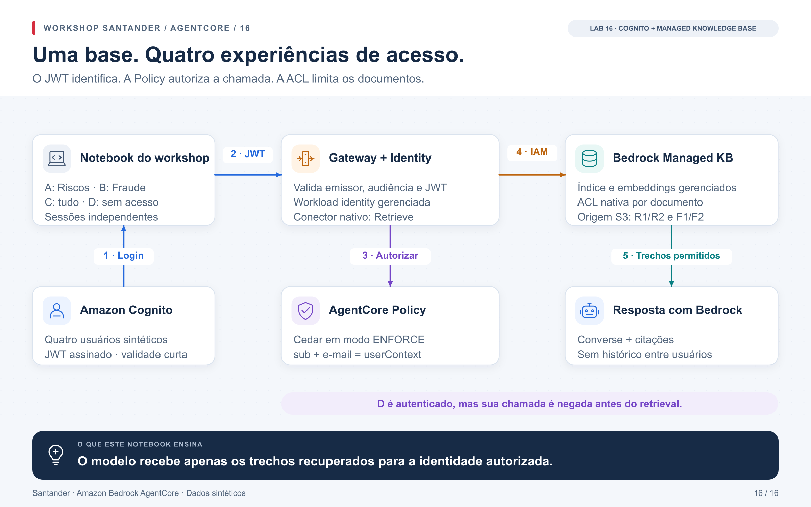

# Workshop AgentCore — da primeira ferramenta ao acesso governado a dados

Um agente recebe uma pergunta, escolhe uma ferramenta e consulta uma fonte de dados.
Esse caminho parece simples até precisarmos responder: **quem está agindo, o que
pode fazer, onde a decisão é aplicada e como provar o resultado?**

Este workshop constrói essas respostas com Amazon Bedrock AgentCore. Começamos
com chamadas locais e acrescentamos identidade, autorização, descoberta,
implantação por Terraform, múltiplas contas e acesso a documentos por usuário.
Os exemplos bancários usam apenas dados sintéticos.

O material foi pensado para desenvolvedores e arquitetos com noções de Python,
APIs e IAM. Ao concluir, você deve conseguir desenhar as fronteiras de confiança,
criar controles por identidade e demonstrar tanto uma consulta permitida quanto
uma negativa esperada. Os conceitos de MCP, JWT, OBO, Cedar e ACL são apresentados
durante os exercícios e reunidos no [glossário](docs/conceitos.md).

**Comece pela [preparação do ambiente](docs/preparacao.md) e pelo
[notebook 00 — primeira execução](notebooks/00_preflight.ipynb).**
Os 17 notebooks têm explicações em português, diagramas, código executável e
links para a documentação oficial. O [guia da jornada](docs/jornada.md) explica
os objetivos e os pontos de verificação de cada etapa.

## A história que vamos construir

### 1. Fazer uma chamada e entender seus componentes

Nos notebooks [00](notebooks/00_preflight.ipynb) e
[01](notebooks/01_gateway_targets.ipynb), conhecemos a bancada e publicamos o
contrato de uma ferramenta. Aprendemos o que Gateway e MCP fazem, como os
argumentos chegam ao backend e por que uma ferramenta não precisa ser um agente.
A execução local permite observar esse fluxo antes de implantar serviços.

### 2. Distinguir a pessoa, a aplicação e a permissão

O [02](notebooks/02_identity_entra_obo.ipynb) introduz JWT e delegação OBO.
O [03](notebooks/03_identity_agente_mcp.ipynb) mantém a pessoa e troca o agente:
a decisão pode mudar porque são identidades diferentes. No
[04](notebooks/04_policy_cedar.ipynb), expressamos as condições em Cedar.
O [05](notebooks/05_policy_autoria.ipynb) separa escrever, revisar e publicar
uma política. Autenticar uma chamada passa a ser apenas o primeiro controle.

### 3. Descobrir capacidades com governança

No [06](notebooks/06_registry_governanca.ipynb), uma capacidade é publicada,
submetida e aprovada no Registry. No
[07](notebooks/07_registry_personas.ipynb), acompanhamos o desenvolvedor, o
publicador, o aprovador e o consumidor na entrega de um MCP e de um agente.
O ciclo inclui testes, revisão do bundle e separação de permissões. No
[08](notebooks/08_registry_descoberta_execucao.ipynb), o consumidor encontra essa
capacidade e chama o Gateway. A descoberta informa o que existe; a autorização
continua sendo avaliada em cada execução.

### 4. Implantar a primeira solução em uma conta AWS

O [09 — Runtime, Gateway e Identity com Terraform](notebooks/09_terraform_runtime_gateway_identity.ipynb)
reúne um fluxo pequeno e completo: Runtime Python → Identity → Gateway → Lambda.
Cognito fornece o token de aplicação. Construímos o pacote, revisamos o plano,
aplicamos a infraestrutura e testamos chamadas aceitas e rejeitadas. Depois,
um modelo Bedrock usa a mesma ferramenta. O [guia de implantação](docs/terraform/README.md)
detalha os recursos, os testes e a remoção.

Uma única conta facilita aprender o ciclo de implantação antes de distribuir
a solução entre equipes.

### 5. Distribuir ferramentas e decisões entre contas

O [10](notebooks/10_santander_multi_conta.ipynb) apresenta as fronteiras entre
contas e o uso de STS. O [11](notebooks/11_blog_multi_account_gateway_mcp.ipynb)
coloca um agente central em Runtime para consultar três áreas bancárias por M2M.
O [12](notebooks/12_gateways_por_conta_identity_policy.ipynb) acrescenta um Gateway
e uma Policy por área, preservando o usuário por OBO até os MCPs. Comparamos
onde a delegação termina e quem tem a palavra final sobre uma consulta.

### 6. Levar a identidade até a fonte de dados

No [13](notebooks/13_databricks_e_evidencias.ipynb), isolamos duas provas:
qual usuário o Databricks reconhece e qual tabela ele pode consultar.
O [14](notebooks/14_cenario_santander_integrado.ipynb) compõe esse aprendizado com
agentes Riscos/Fraude, Registry e três Gateways. Uma negativa na Policy e uma
negativa no Unity Catalog acontecem em fronteiras diferentes; os logs precisam
mostrar qual delas decidiu.

### 7. Recuperar documentos sem perder suas permissões

O [15](notebooks/15_ingestao_acl_memoria.ipynb) exercita localmente atualização,
revogação, exclusão e memória por usuário. O
[16](notebooks/16_rag_managed_identity_policy.ipynb) leva o controle documental
para uma Managed Knowledge Base na AWS: Cognito autentica, Policy vincula o
usuário à consulta, a ACL filtra os documentos e o modelo recebe os trechos
autorizados. A aprendizagem termina na relação entre identidade, recuperação
e geração de resposta.

## O desafio final: a mesma pergunta, quatro permissões

No laboratório 16, todos tentam consultar a mesma base com a mesma ferramenta.
A identidade autenticada determina quais documentos podem entrar no contexto
do modelo:

| Usuário | Riscos — R1/R2 | Fraude — F1/F2 | Resultado esperado |
|---|---|---|---|
| A | Permitido | Negado | Resposta baseada somente em Riscos |
| B | Negado | Permitido | Resposta baseada somente em Fraude |
| C | Permitido | Permitido | Pode consultar as duas áreas |
| D | Negado | Negado | Policy nega a chamada; nenhuma geração |



O cenário é autocontido em uma conta AWS: o CloudFormation cria Cognito,
quatro usuários sintéticos, senhas no Secrets Manager, documentos no S3,
Managed Knowledge Base, Gateway, Identity, Policy e logs. Os testes de referência
usam o perfil `default` em `us-east-1`; o [runbook](docs/rag/README.md) explica
como selecionar o ambiente. Este caminho usa Cognito e não exige um tenant Entra.

O Gateway verifica o JWT. Três regras Cedar permitem A/B/C e vinculam a
identidade assinada ao `userContext` enviado à KB. D não possui `permit`.
A ACL nativa da Managed KB determina os documentos autorizados; a role da
aplicação tem uma negação IAM de retrieval direto para impedir esse desvio.
O código confere os trechos antes de chamar o modelo.

AgentCore Identity também emite um WAT associado à workload e a cada usuário,
inclusive D. Esse exercício mostra que **ter identidade não concede acesso
aos documentos**. O WAT não substitui o JWT de entrada do Gateway. O conector
nativo usa IAM para acessar Bedrock; OBO aparece nas trilhas com destinos OAuth.

O notebook mostra as três policies completas, as ACLs de Riscos/Fraude e os
recursos que as criam pelo IaC. As matrizes e consultas comparam **esperado × observado ×
PASS/FAIL** antes da asserção. Além de A/B/C/D, há uma tentativa de A enviar a
identidade de C, chamadas sem JWT/com JWT inválido e retrieval direto negado.
Uma busca semântica pode retornar parte dos documentos permitidos; consultas
adicionais conferem a cobertura das permissões.

Os diagramas de [provisionamento](docs/rag/provisionamento.svg) e de
[decisão de acesso e falhas](docs/rag/decisao-acesso.svg) complementam a arquitetura.
Os três estão incorporados ao [notebook 16](notebooks/16_rag_managed_identity_policy.ipynb).

## Escolher por onde começar

| Objetivo | Percurso | Ambiente necessário |
|---|---|---|
| Aprender os fundamentos | 00–07, depois seguir a jornada | Python e `uv`; execução local |
| Fazer a primeira implantação AWS | Fundamentos → 09 | Uma conta AWS e Terraform; Cognito M2M, Runtime, Gateway e Lambda |
| Demonstrar RAG com permissões por pessoa | Preparação → 15 → 16 | Parte local sem AWS; parte real cria seu próprio ambiente AWS/Cognito por CloudFormation |
| Explorar múltiplas contas e dados corporativos | 10 → 11 → 12 → 13 → 14 | Contas, IdPs e fontes de dados conforme o guia de cada cenário |

As trilhas têm configurações e ciclos de vida próprios. O laboratório 09 ensina
autenticação de aplicação e não implanta uma engine Cedar nem os recursos do RAG.
Nos cenários Entra/Okta/Databricks, siga os pré-requisitos específicos; a criação
do Cognito no laboratório 16 não provisiona esses sistemas. A jornada completa
ocupa várias sessões, e os tempos dos notebooks não incluem preparação externa
ou provisionamento.

## Executar a bancada

Na raiz do repositório, com Python 3.12 ou 3.13 e `uv` instalado:

```bash
uv sync --frozen --extra banking
uv run --frozen --extra banking santander-demo demo
uv run --frozen --extra banking santander-demo matrix
```

Abra o notebook 00 no VS Code ou Jupyter e selecione `.venv/bin/python` como
kernel. Siga a sequência **00 a 16**. A numeração acompanha a evolução dos
conceitos, da primeira chamada à governança e aos cenários de múltiplas contas e RAG.

Todos os notebooks começam com execução de nuvem desativada. A bancada local
ensina os contratos e verifica o código; as etapas AWS exigem implantação e
credenciais do cenário. Uma execução local não comprova a integração gerenciada.
O [guia de validação](docs/validacao.md) explica como interpretar cada resultado.

Os verificadores do [guia de validação](docs/validacao.md) comparam o conteúdo
com dados e efeitos observados, incluindo falhas injetadas e conferência de
fontes e logs na AWS. Cada trilha declara seus pré-requisitos e o alcance
da prova; uma etapa desativada permanece `NOT_RUN`.

Para uma aula, percorra cada explicação, antecipe o resultado e só então execute
a célula. Compare o observado com o esperado e encerre pela limpeza local.
No RAG, `RUN_AWS` habilita as consultas reais, enquanto `RUN_PIPELINE` e
`APPLY_CHANGESET` controlam o provisionamento separadamente. Um ambiente já
implantado pode ser testado mantendo o pipeline desativado.

## Do código testado ao notebook e à infraestrutura

O notebook usa funções do pacote Python do repositório. Para alterar um cenário,
implemente e teste o código, regenere seu notebook e execute as células em um
kernel novo. Valide a integração AWS separadamente, quando o ambiente estiver preparado.
As explicações seguem a sequência **problema → motivo do controle → código →
resultado esperado → verificação**.

| Pasta | O que você encontra |
|---|---|
| [notebooks/](notebooks/) | Os 17 laboratórios, com imagens incorporadas e controles de execução |
| [src/santander_demo/](src/santander_demo/) | Clientes, autenticação, autorização e código dos cenários |
| [tests/](tests/) | Casos permitidos, negativas, contratos e testes de isolamento |
| [infra/](infra/) | Geradores/templates CloudFormation e configurações Terraform |
| [scripts/](scripts/) | Build, deploy, verificação, geração dos notebooks e limpeza |
| [config/](config/) | Exemplos; os arquivos `local.*` do operador ficam fora do Git |
| [docs/](docs/) | Jornada, conceitos, diagramas e guias operacionais |
| `evidence/` | Relatórios e cópias executadas gerados localmente, fora do Git |

Para mudar uma permissão, altere sua fonte, execute os testes, revise o plano
e aplique pelo wrapper IaC do cenário. Usuários, roles, policies e ACLs são
gerenciados por esse fluxo, inclusive quando um custom resource realiza a
publicação e a ingestão. Evite correções manuais que deixem o ambiente diferente
do código. No RAG, alterações de ACL no S3 precisam de nova ingestão.

## Como validar o cenário escolhido

Execute os verificadores ao mudar o código, as permissões ou o ambiente.
Compare o resultado com o contrato do cenário e confira sua origem nos
dados e nos logs dos serviços.

| Cenário | O que precisa ser comprovado | Guia |
|---|---|---|
| 07 — Quatro personas no Registry | Visibilidade por estado, consumo do agente, separação de papéis e negativa da sessão limitada à descoberta | [Ciclo de vida do Registry](docs/registry/README.md#leitura-dos-resultados) |
| 09 — Terraform/M2M | Negativas de autenticação, dados C001/C002, uso da ferramenta pelo modelo, IDs de execução e drift | [Validação Terraform](docs/validacao.md#laboratório-09) |
| 16 — RAG por usuário | Matriz A/B/C/D, falsificação negada, ACLs na fonte, contexto do modelo e decisão nativa do Policy | [Validação do RAG](docs/rag/validacao.md) |

Os cenários Entra/Okta/Databricks exigem contas, aplicações e fontes próprias.
O Cognito criado pelas trilhas autocontidas não prepara esses ambientes.
O [guia de validação](docs/validacao.md) define o que observar em cada fronteira,
incluindo os limites dos erros genéricos e das simulações locais.

## Material de apoio

| Preciso de… | Onde encontrar |
|---|---|
| Objetivos, sequência e pontos de verificação | [Jornada de aprendizagem](docs/jornada.md) |
| Instalação, kernel e configuração | [Preparação](docs/preparacao.md) |
| Definições de JWT, OBO, WAT, Policy, ACL e RAG | [Conceitos](docs/conceitos.md) |
| Imagens para estudar ou apresentar | [Galeria dos 17 laboratórios](docs/diagramas/index.html) · [Diagramas adicionais do RAG](docs/rag/README.md#o-que-observar-no-notebook) |
| Primeira implantação por Terraform | [Laboratório 09](docs/terraform/README.md) |
| Infraestrutura compartilhada dos módulos 00–06, 08, 10 e 13 | [Guia de implantação](docs/deploy.md) |
| Agente central e federação de Gateways | [Laboratório 11](docs/banking/README.md) · [Laboratório 12](docs/federation/README.md) |
| Integração com Databricks e correlação | [Laboratório 14](docs/journey/README.md) · [Trace](docs/journey/trace.md) |
| Documentos, memória e RAG por usuário | [Laboratório 15](docs/ingestao/README.md) · [Laboratório 16](docs/rag/README.md) |
| Testes e encerramento dos ambientes | [Validação](docs/validacao.md) · [Limpeza](docs/cleanup.md) |

## Interpretar os resultados e encerrar

A execução local funciona sem uma conta AWS. A implantação é opcional e usa
exclusivamente o IaC de cada laboratório. Os cenários multi-conta dependem
também das identidades e fontes descritas nos respectivos guias; não são
etapas que o deploy do laboratório 09 provisiona automaticamente.

Uma negativa esperada pode ser um teste aprovado: D receber `DENY` é o
comportamento correto. Timeout, credencial expirada e erro do modelo são falhas
operacionais. `LOCAL_SIMULATION`/`LOCAL_CONTRACT` identificam o caminho local;
`NOT_RUN` indica uma etapa pulada; `PENDING_EVIDENCE` exige examinar o que falta.
Se apenas os logs do RAG estiverem pendentes, repita a correlação conforme o
runbook, sem refazer as consultas.

Os notebooks de origem ficam sem outputs; os resultados aparecem ao executar.
Os verificadores gravam relatórios em `evidence/`; alguns também salvam cópias
executadas. O verificador AWS do RAG preserva somente o relatório sanitizado.
Revise as saídas antes de compartilhar e mantenha tokens, senhas, state e planos
Terraform fora do Git.

Limpar as variáveis do notebook não remove a infraestrutura. Serviços e
inferências podem gerar custos; use o [guia de limpeza](docs/cleanup.md) para
encerrar o ambiente correto pelo IaC. No RAG, a remoção normal dos stacks
preserva KB, fonte e buckets conforme suas políticas de retenção. O guia do
cenário explica esse ciclo de vida.

Consulte [NOTICE.md](NOTICE.md) para atribuição dos exemplos adaptados e licenças.
