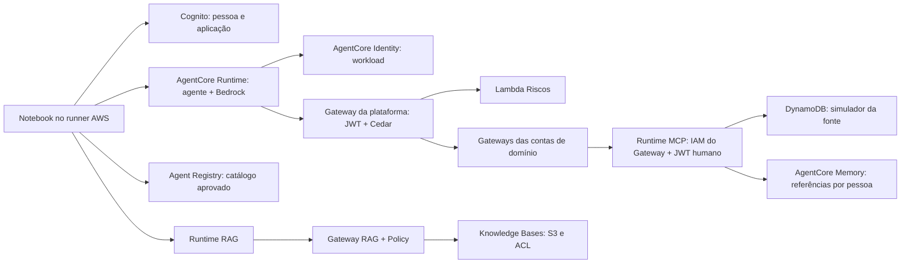

# Santander — Workshop Amazon Bedrock AgentCore

**Pré-requisito da jornada completa: quatro contas AWS distintas em `us-east-1`,
preparadas por IaC. As aulas 10–14 não funcionam em conta única.** A aula 14
ensina um fluxo de três contas, mas depende da implantação completa de quatro.
O runner CodeBuild atual também exige esse ambiente, inclusive com `--labs`.
Confira a [matriz de contas e seleção das aulas](docs/contas-e-elegibilidade.md)
antes de executar o workshop.

Jornada de 17 aulas com serviços e agentes implantados na AWS: Runtime,
Gateway, Identity, Policy, Agent Registry, Memory e Bedrock Knowledge Bases.
Os notebooks mostram o código, explicam cada fronteira de autorização e
consultam os recursos reais. Não há seletor de ambiente de execução.

O provedor padrão é Amazon Cognito. O material explica como os conceitos se
aplicam ao Microsoft Entra ID e onde os protocolos diferem. A fonte Databricks
foi substituída, por decisão de escopo, por um **simulador hospedado na AWS**
(Runtime + DynamoDB). Seus dados e permissões são sintéticos; o aceite não
comprova SQL Warehouse ou Unity Catalog reais.

[Aceite AWS de 03/11/2026](docs/aceite-aws.md): 17 aulas e o ciclo completo de
atualização, revogação, exclusão e reingestão passaram **no ambiente de
referência de quatro contas**, para o pacote de fonte registrado nesse build.

## Começar

1. Escolha as aulas pela [matriz de contas](docs/contas-e-elegibilidade.md).
   Para a jornada completa, configure os IDs das quatro contas.
2. Siga [implantação](docs/deploy.md): todos os recursos pertencem ao IaC.
3. Execute as aulas em CodeBuild ou em um ambiente de notebooks na AWS.
4. Confira [validação](docs/validacao.md) e as evidências da execução escolhida.

O computador do operador pode editar o projeto, compilar artefatos e acionar o
pipeline. Os agentes, ferramentas, inferência, dados, memória e execução de
aceite permanecem na AWS. Credenciais e saídas executadas não pertencem ao Git.

## Serviços e fronteiras



A autorização considera a pessoa, o app client, a ferramenta e os parâmetros.
A fonte verifica a ACL novamente. Uma descoberta no catálogo não concede
permissão para invocar um agente. A memória guarda referências e revalida os
grants antes de devolver conteúdo.

## Aulas

| Aula | Serviço e experiência | Contas exigidas pelo notebook atual |
|---|---|---|
| 00 | STS, CloudFormation, preflight e negativa anônima | 1 |
| 01 | Gateway: target Lambda e servidor MCP no Runtime | 1 |
| 02 | Cognito, JWT humano, workload Identity e agente no Runtime | 1 |
| 03 | Mesma pessoa, apps Supervisor e Riscos com permissões diferentes | 1 |
| 04 | Policy Cedar em ENFORCE: casos permitidos e negados | 1 |
| 05 | Geração assistida de rascunho, leitura e revisão pelo IaC | 1 |
| 06–08 | Registry: governança, personas, descoberta e execução | 1 |
| 09 | Terraform: Runtime → Identity → Gateway → Lambda | 1 |
| 10 | Quatro contas verificadas pelo STS | **4** |
| 11–12 | Gateway da plataforma e Gateways por domínio | **4** |
| 13 | Simulador Databricks na AWS: identidade e grants independentes | **4** |
| 14 | Origem → plataforma → fonte: fluxo de 3 contas | **4 no IaC atual** |
| 15 | Memory: isolamento por pessoa e reautorização da fonte | 1 |
| 16 | RAG gerenciado: usuários A/B/C/D, retrieval, ACL e geração | 1 |

Uma conta precisa conter os stacks e integrações da aula. A coluna não reduz
o requisito de quatro contas do runner completo.

[Detalhamento da jornada](docs/jornada.md) · [Conceitos de identidade](docs/conceitos.md)

## Código e validação

- `infra/workshop/generate.py`: templates CloudFormation da jornada.
- `src/santander_demo/aws_workshop/`: agentes, cliente MCP, fonte e identidade.
- `scripts/aws_notebook_lessons.py`: conteúdo das aulas; `generate_aws_notebooks.py`
  gera notebooks determinísticos, sem credenciais e sem saídas executadas.
- `scripts/workshop_runner.py`: fonte privada, IaC do CodeBuild e coleta de evidências.
- `scripts/workshop_catalog.py`: publicação, submissão e decisão revisada dos agentes de origem.
- `scripts/workshop_lifecycle.py`: transições de documentos/ACL e verificação da mesma referência no Memory.

```bash
uv sync --frozen --extra banking
uv run python scripts/generate_aws_notebooks.py
uv run python scripts/verify_notebooks.py --validate-only
uv run pytest -q
```

Esses comandos verificam código e material. Aceite operacional exige execução
na AWS; veja [validação](docs/validacao.md). A [limpeza](docs/cleanup.md) é uma
operação separada do pipeline e não acontece ao concluir uma aula.

## Referências

Base conceitual e didática: [workshops oficiais AgentCore](https://github.com/awslabs/agentcore-samples/tree/main/06-workshops).
As APIs e o IaC deste projeto adaptam esses exemplos à jornada. Agent Registry
usa `agent-registry-control` e `agent-registry`, conforme a
[migração do serviço](https://docs.aws.amazon.com/bedrock-agentcore/latest/devguide/registry-faq.html).
O [plano da revisão](docs/plano-revisao-aws.md) registra o escopo e o andamento.
