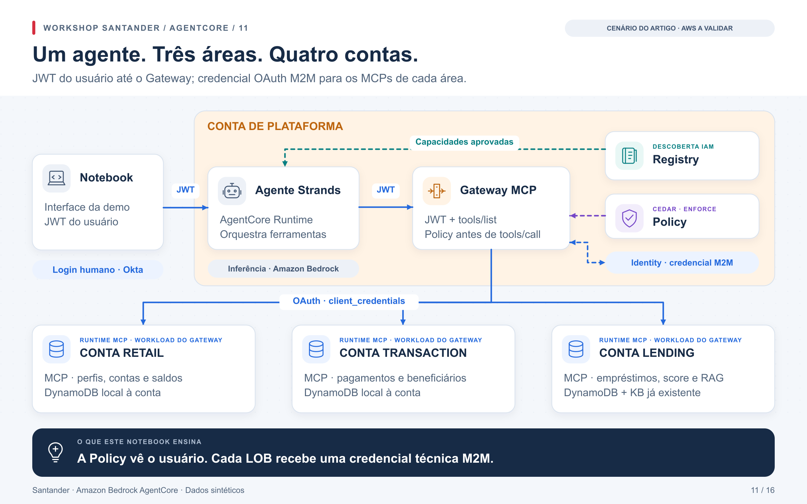

# Laboratório 11 — um agente consulta três áreas de negócio

Após compreender a [topologia entre contas no notebook 10](../../notebooks/10_santander_multi_conta.ipynb),
vamos hospedar um agente central e distribuir suas ferramentas entre Retail,
Transaction e Lending. A pergunta agora é: como consultar capacidades mantidas
por equipes diferentes sem conceder ao agente acesso direto a todas as bases?

[Abrir notebook 11](../../notebooks/11_blog_multi_account_gateway_mcp.ipynb) ·
[Voltar à jornada](../jornada.md)



## Entender o fluxo

O agente Strands roda no AgentCore Runtime da plataforma. Recebe o JWT humano
Okta e o encaminha ao Gateway. A Policy avalia essa identidade e a ferramenta.
Identity obtém uma credencial OAuth M2M para chamar o Runtime MCP da área.
Cada MCP usa sua role IAM para consultar as tabelas locais; Lending também
consulta uma Knowledge Base existente.

A delegação humana termina no Gateway central. As fontes recebem chamadas
com identidades técnicas. Esse detalhe será a motivação do
[laboratório 12](../federation/README.md), que preserva o usuário até os MCPs.

| Componente | O que observar |
|---|---|
| Runtime central | Ciclo Strands/Bedrock: escolher ferramenta, ler resultado e responder |
| Gateway e Policy | Ferramentas disponíveis e autorização da chamada |
| Identity | Troca `CLIENT_CREDENTIALS` sem entregar o segredo ao agente |
| Retail e Transaction | Consultas DynamoDB pelas roles locais |
| Lending | Consultas de crédito e `Retrieve` na KB local |
| Registry | Três capacidades aprovadas, consumidas por IAM |
| Guardrail | Avaliação explícita de conteúdo; não substitui a Policy de ferramentas |

São expostos 16 schemas. O exercício usa as 12 ferramentas de consulta/cálculo;
as três de escrita ficam sem `permit` e sem IAM de escrita. `delete_customer`
é um stub não destrutivo com `forbid` explícito. O roteiro não executa transferência.

## Preparar as dependências

São necessárias quatro contas de laboratório distintas na mesma região,
perfis de implantação e acesso ao modelo Bedrock na plataforma. Para inference
profiles entre regiões, declare no IAM o profile e todos os ARNs de modelos
destino retornados por `get-inference-profile`.

O IdP Okta precisa de custom authorization server, audiência `lobfederation`,
scope `lobfederation.invoke`, aplicação de login e cliente M2M. O segredo M2M
fica no Secrets Manager da plataforma como JSON com chave `client_secret`.
Essas identidades e seu consentimento pertencem ao IaC do tenant.

Lending precisa de uma KB ativa e já ingerida com documentos sintéticos.
A KB, seus documentos e o armazenamento vetorial são pré-requisitos sob o IaC
da fonte. O laboratório consulta essa base, mas não a cria.

```bash
uv sync --frozen --extra banking
uv run --frozen --extra banking python infra/banking/generate.py
uv run --frozen cfn-lint infra/banking/templates/*.json
uv run --frozen --extra banking python scripts/build_artifacts.py --banking
cp config/banking.example.json config/local.banking.json
```

Preencha somente identificadores e ARNs no JSON. O token é solicitado em memória
por `getpass`. O build local produz o ZIP Linux ARM64/Python 3.12 usado pelos
Runtimes e providers.

## Implantar por fases

No notebook, `RUN_AWS=True` habilita acesso AWS. Selecione `DEPLOY_PHASE` na ordem
abaixo e execute novamente configuração, sessões e preparação a cada fase.

| Fase | Resultado |
|---|---|
| `bootstrap` | Bucket de artefatos em cada conta |
| `platform` | Gateway, provider M2M, engine, Guardrail e logs |
| `lobs` | Tabelas, fixtures e Runtimes das três áreas |
| `bindings` | Targets, políticas e Registry com registros aprovados |
| `agent` | Runtime Strands central |

A preparação lê outputs e gera parâmetros concretos. `RUN_PIPELINE=False`
somente mostra comandos e grava arquivos locais. Com `RUN_PIPELINE=True`, o
wrapper publica artefatos e prepara change sets; `APPLY_CHANGESET=True` aplica
as mudanças pelo CloudFormation. Revise cada conjunto antes da aplicação.
Ao terminar, volte `DEPLOY_PHASE=None` e execute o preflight completo.

## Verificar o aprendizado

Okta identifica o cliente com `cid`. Os authorizers usam `CustomClaims` para
verificá-lo; `AllowedClients`, que verifica `client_id`, não é equivalente.
O Gateway deve aceitar apenas os endpoints e scopes declarados. O agente
confere os registros aprovados e não envia tokens a URLs arbitrárias.

Execute consultas nas três áreas, observe uma negativa Cedar específica e
faça a pergunta ao agente hospedado. O teste exige resultados de ferramentas
das três LOBs. Uma resposta textual sem essas chamadas não aprova o exercício.
O resumo exportado contém ferramentas, status e hashes, sem JWT ou conteúdo
bancário. Com `RUN_AWS=False`, as integrações permanecem `NOT_RUN`.

## Remoção

Remova `agent` → `bindings` → três LOBs → `platform` → quatro `bootstrap`, usando
`cleanup.py --scenario banking` e o [procedimento de limpeza](../cleanup.md).
Tabelas e buckets usam `Retain`; KB e identidades externas continuam sob seus
respectivos proprietários.

No [laboratório 12](../federation/README.md), cada área ganha sua própria Policy
no Gateway, e comparamos negativas em duas fronteiras.

## Referências

- [Artigo AWS sobre agente multi-conta](https://aws.amazon.com/blogs/machine-learning/build-a-multi-account-ai-agent-with-agentcore-gateway-and-mcp/)
- [Autenticação de saída do Gateway](https://docs.aws.amazon.com/bedrock-agentcore/latest/devguide/gateway-outbound-auth.html)
- [Bedrock Guardrails](https://docs.aws.amazon.com/bedrock/latest/userguide/guardrails.html)
- [Atribuição e adaptações dos exemplos](../../NOTICE.md)
- [Licença original MIT-0](UPSTREAM-LICENSE)
