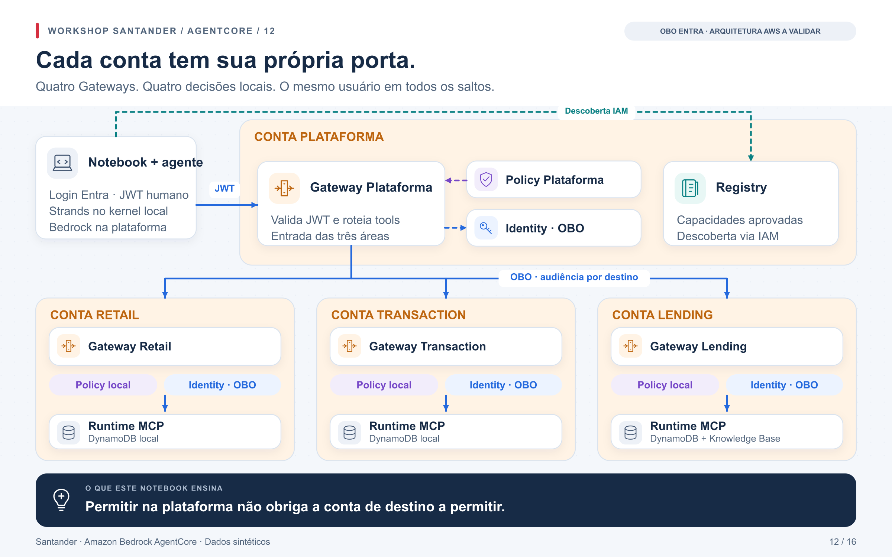

# Laboratório 12 — cada área decide sobre suas ferramentas

No [laboratório 11](../banking/README.md), a autorização está concentrada no
Gateway da plataforma. Agora cada área ganha seu próprio Gateway, Identity e
Policy. Uma permissão na plataforma deixa de ser suficiente: a conta de negócio
também precisa aceitar a chamada.

[Abrir notebook 12](../../notebooks/12_gateways_por_conta_identity_policy.ipynb) ·
[Configuração](../../config/federation.example.json) · [Jornada](../jornada.md)



## Seguir o usuário entre os componentes

O agente Strands executa no **kernel do notebook**, usando Bedrock na plataforma.
O JWT Entra do usuário entra no Gateway Plataforma. Após a Policy central,
Identity faz OBO para o Gateway da área. Esse Gateway valida o novo token,
aplica sua Policy e faz outro OBO para seu Runtime MCP.

| Trecho de Retail | Audiência `aud` | Aplicação `azp` |
|---|---|---|
| Notebook → Plataforma | App Gateway Plataforma | App Login |
| Plataforma → Retail | App Gateway Retail | App Gateway Plataforma |
| Retail → Runtime MCP | App Runtime Retail | App Gateway Retail |

Transaction e Lending repetem o desenho. `tid` + `oid` identifica a mesma pessoa;
`sub` pode variar entre aplicações. Os tokens Entra v2 usam exatamente
`scp == "access_as_user"`; scopes adicionais exigem mudar o contrato e seus
testes. O OBO solicita `api://<app-destino>/.default`.

Os targets usam `TOKEN_EXCHANGE`; os providers usam `JWT_AUTHORIZATION_GRANT`
com `requested_token_use=on_behalf_of`. Cada segredo pertence à conta do Gateway.
A restrição de workload vale no trecho Gateway local → Runtime. Entre Gateways,
`azp` verifica a aplicação, sem comprovar origem de rede; os endpoints são
públicos autenticados.

A identidade humana chega aos MCPs, mas DynamoDB e KB ainda são consultados por
roles IAM locais. Grants por pessoa na fonte serão estudados no
[notebook 13](../../notebooks/13_databricks_e_evidencias.ipynb).

## Preparar o ambiente

O laboratório requer quatro contas distintas, uma região compatível, perfis
AWS e modelo Bedrock autorizado. Lending precisa de KB sintética já ingerida.
O perfil usado pelo agente precisa invocar o modelo, aplicar o Guardrail e
pesquisar o Registry; a plataforma não recebe acesso IAM direto às tabelas.

O IaC do tenant Entra deve fornecer oito aplicações: login público, quatro
Gateways e três Runtimes. São sete grants delegados: login → plataforma,
plataforma → três Gateways e cada Gateway → seu Runtime. Configure tokens v2,
um único scope `access_as_user` e consentimento administrativo. Guarde os quatro
segredos dos Gateways no Secrets Manager de suas contas como `client_secret`.
O usuário precisa estar nas allowlists e usar um fluxo interativo permitido.

O módulo `infra/entra` pertence à bancada 00–06, 08, 10 e 13 e não provisiona essa topologia.
Se o segredo usar uma chave KMS própria, inclua as permissões no IaC.

```bash
uv sync --frozen --extra banking
uv run --frozen --extra banking python infra/federation/generate.py
uv run --frozen cfn-lint infra/federation/templates/*.json
uv run --frozen --extra banking python scripts/build_artifacts.py --banking
cp config/federation.example.json config/local.federation.json
```

Use um `project` próprio para separar esse ambiente do laboratório 11.

## Implantar e observar

O notebook resolve outputs e gera os comandos do wrapper
`banking_deploy.py --scenario federation`. Use as flags de implantação
explicadas em [preparação](../preparacao.md).

| `DEPLOY_PHASE` | Stacks | Conteúdo |
|---|---|---|
| `bootstrap` | 4 | Artefatos |
| `gateways` | 4 | Gateways, providers OBO, engines e logs |
| `backends` | 3 | MCPs, tabelas e fixtures |
| `domain-bindings` | 3 | Gateway local → Runtime e Policies locais |
| `platform-bindings` | 1 | Plataforma → Gateways das áreas e Policy central |
| `registry` | 1 | Catálogo, registros e aprovação |

São 13 templates reutilizados em 16 stacks. Revise os change sets e aplique pelo
wrapper. Os schemas MCP são estáticos: modificar contratos exige regenerar e
reimplantar bindings e registros, sem sincronização avulsa de targets.

## Comparar permissões e negativas

1. Confirme os quatro engines em `ENFORCE` e consulte C003 pelas três áreas.
2. Execute `whoami` através da plataforma. O Runtime verifica o JWT e retorna
   uma prova reduzida: hash de `tid:oid`, audiência e aplicação. Compare a mesma
   pessoa e os destinatários/atores esperados em cada destino.
3. Chame `get_profile(C007)`: o contrato nega na plataforma.
4. Chame `get_profile(C008)`: a plataforma permite, mas Retail nega.
5. Envie o JWT da plataforma diretamente ao Gateway Retail: a audiência errada
   deve ser rejeitada. Isso testa o JWT, não a restrição de workload do Runtime.
6. Opcionalmente execute uma pergunta pelo agente e examine nomes como
   `retail___backend___get_profile`, que mostram os dois targets atravessados.

As negativas C007/C008 são específicas de `get_profile`; não constituem uma ACL
global desses clientes para todas as ferramentas. Verifique a decisão e a
fronteira nos logs. Um erro de rede ou uma credencial inválida não demonstra
negação pela Policy. Consulte [validação](../validacao.md).

## Remoção

Remova `registry` → `platform-bindings` → bindings das áreas → backends →
Gateways → bootstrap pelo [wrapper de limpeza](../cleanup.md), cenário
`federation`. Os recursos retidos e pré-requisitos externos têm ciclo próprio.

Avance ao [13](../../notebooks/13_databricks_e_evidencias.ipynb) para testar a
identidade no Databricks antes de compor o cenário integrado.

## Referências

- [OBO no Microsoft Entra](https://learn.microsoft.com/en-us/entra/identity-platform/v2-oauth2-on-behalf-of-flow)
- [OBO no AgentCore Identity](https://docs.aws.amazon.com/bedrock-agentcore/latest/devguide/on-behalf-of-token-exchange.html)
- [Authorizer JWT](https://docs.aws.amazon.com/bedrock-agentcore/latest/devguide/inbound-jwt-authorizer.html)
- [Atribuição dos MCPs e fixtures](../../NOTICE.md)
