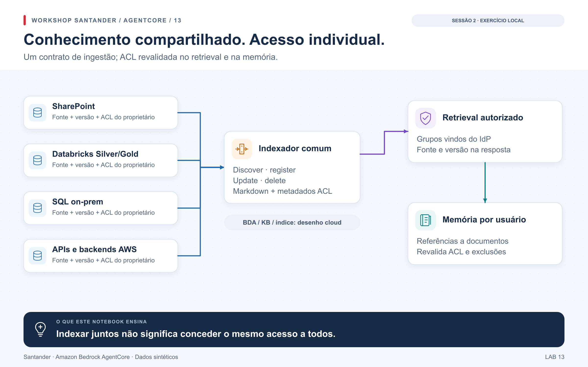

# Sessão 2 — ingestão e autorização do conhecimento

O [notebook 13](../../notebooks/13_ingestao_acl_memoria.ipynb) implementa um
exercício local de indexação e ACL com conteúdo sintético. Demonstra registro,
consulta, mudança de permissão, exclusão e isolamento de memória. Não executa
conectores SharePoint/SQL/Databricks, BDA, KB, OpenSearch ou Memory gerenciado.

## Agenda de quatro horas

| Minutos | Atividade | Entrega |
|---|---|---|
| 0–30 | Fonte, owner, curadoria e BDAGs | Contrato de metadados de uma fonte escolhida |
| 30–70 | Discover/register/update/delete | Exercício de lifecycle do notebook 13 |
| 70–100 | Documentos → Markdown → chunks/índice | Desenho BDA/indexador e limites por tipo de documento |
| 100–115 | Intervalo | — |
| 115–165 | KB compartilhada com dois usuários | Retrieval com ACL, negativa e mudança de grupos |
| 165–195 | Revogação, delete, caches e memória | Provas do notebook; contrato para serviços gerenciados |
| 195–225 | Integração com K2/instâncias e fontes restantes | Contrato de conectores e responsabilidades |
| 225–240 | Context, grafos e próximos testes | Pendências com owner e critério de conclusão |

## Contrato comum de ingestão

Preservar `source_id`, `document_id`, versão/ETag, checksum, URI de origem,
owner, ACL/grupos e instante de sincronização. Um conteúdo normalizado não pode
perder a associação à ACL original. Atualizações devem ser idempotentes;
exclusões precisam de tombstones/reconciliação e remoção de chunks antigos.

| Fonte | Entrada do conector | Autoridade de autorização |
|---|---|---|
| SharePoint pages/documentos | Curadoria, delta/versões, conteúdo e permissões | ACL da origem + grupos Entra sincronizados |
| Databricks Silver/Gold | Dataset aprovado e versão; identidade/grants | Unity Catalog e BDAGs, inclusive filtros/mascaramento quando aplicáveis |
| SQL on-prem | Conector/rede aprovados e extração incremental | Grants/RBAC da origem e contrato de mapeamento |
| API/backend AWS | Contrato de API, versão e owner | Autorização da API/dado; identidade técnica não implica acesso geral humano |

BDA pode normalizar conteúdo; o indexador comum mantém ACL e versionamento.
O índice fica no data plane da instância, conforme o desenho do cliente. A camada
comum pode ser compartilhada como implementação, sem juntar todas as permissões
em uma role com acesso indiscriminado.

No retrieval, o backend deriva filtros da identidade verificada. O usuário/LLM
não fornece seus próprios grupos. A role da KB ou OpenSearch não deve ser uma
rota alternativa para consumidores consultarem dados sem filtro. Quando o
backend não consegue expressar a ACL com segurança, separar índices/KBs é uma
opção a comparar; não reduzir a ACL para caber em um filtro.

## D2K e Memory

As operações `discover`, `register`, `update`, `delete` são o ciclo de ingestão,
não os estados de aprovação de Agent Registry. Elas podem ser expostas como
tools separadas, com políticas por operação/owner e uma aprovação para exclusão.
O notebook executa esse contrato localmente, sem publicar tools de escrita cloud.

Memória deve isolar ator e sessão e revalidar acesso ao recuperar referências.
Salvar texto já recuperado por um usuário não autoriza outro nem sobrevive
automaticamente a uma revogação. O exercício demonstra essa regra usando IDs de
documentos em vez de cópias permanentes do texto.

## Pendências específicas

- **“AWS Context”**: confirmar o nome/URL exato do produto mencionado e o acesso
  no ambiente do cliente. A gravação não é prova de seu status comercial atual;
  Memory e conectores de KB não são apresentados como o mesmo produto.
- **Neptune/grafos**: validar necessidade e fonte antes de definir implantação.
- **Observabilidade como conhecimento**: proposta exploratória; exige classificar
  logs, redigir dados e aplicar retenção/ACL antes de indexar.
- **Ensaio cloud**: escolher um conector, documentos sintéticos e dois usuários;
  reproduzir registro, revogação e delete através do pipeline IaC do owner.

O material desta sessão está preparado. A integração dos serviços e fontes
reais continua sendo uma etapa própria de implementação/ensaio.
