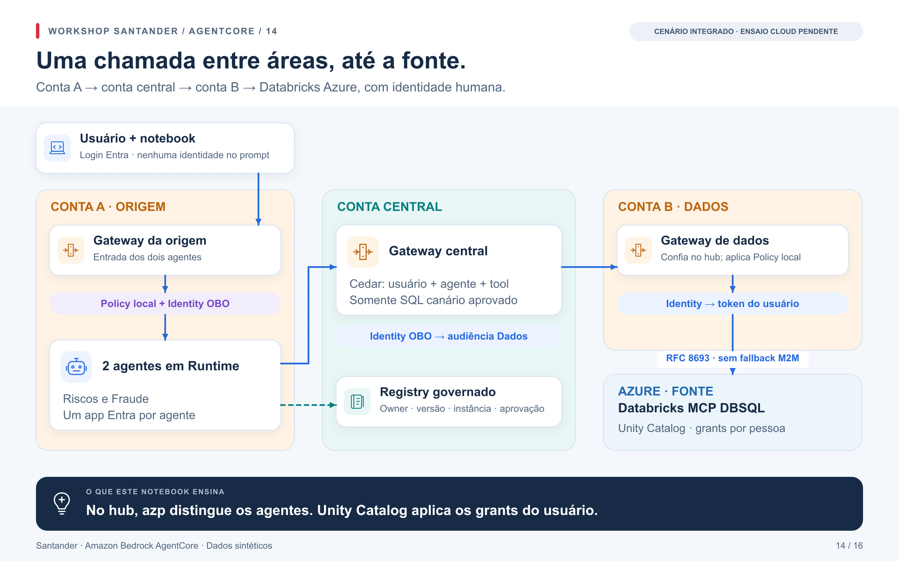

# Laboratório 14 — compor agentes, Gateways e acesso à fonte

No laboratório 12, preservamos a pessoa até os MCPs; no 09, verificamos quem a
fonte reconhece e quais grants aplica. Agora reunimos esses conhecimentos:
agentes Riscos e Fraude na origem → Gateway central → Gateway de dados →
MCP Databricks. Cada fronteira tem uma responsabilidade que precisa ser testada.

[Abrir notebook 14](../../notebooks/14_cenario_santander_integrado.ipynb) ·
[Configuração](../../config/journey.example.json) ·
[Responsabilidades da arquitetura](arquitetura.md) · [Trace](trace.md) ·
[Jornada](../jornada.md)



## O que cada parte acrescenta

| Item | Implementação |
|---|---|
| Dois agentes distinguíveis | Dois Runtimes e duas aplicações Entra na origem; `azp` diferente no Gateway central. Fluxo determinístico para ensaiar autorização. |
| Usuário + agente + tool | Cedar gerado da mesma fonte para testes e CloudFormation; allowlist de OIDs A/B e associação Riscos/Riscos, Fraude/Fraude. |
| Fronteiras por conta | Gateway, engine `ENFORCE`, authorizer Entra e Identity locais. Runtime aceita o workload do Gateway da origem. |
| Fonte real | Target MCP DBSQL, troca RFC 8693 nativa pelo Identity da conta de dados. Não usa o adapter SQL REST do 09. |
| Restrição SQL | Somente `SELECT current_user()` e a consulta canário exata da capacidade; sem SQL escolhido pelo prompt. |
| Catálogo | Owner `dados`, versão `1.0.0`, instância por projeto, publicação pendente e promoção separada. Agentes descobrem por AssumeRole cross-account. |
| Evidências | Request ID, usuário pseudonimizado, agente, tool, hash da query, IDs HTTP do hub e query ID, quando devolvido pelo MCP. |
| Quotas e ingestão | Contratos locais explícitos e matriz de responsabilidades. Não são medição cloud nem conectores produtivos. |

## Preparar as dependências

1. Três contas AWS distintas na mesma região, com perfis e acesso a Gateway,
   Identity, Policy, Registry e Runtime. Endpoints deste lab são públicos
   autenticados; conectividade privada não está implantada.
2. Tenant Entra, dois usuários de teste, admin consent e login Device Code
   permitido, ou um cliente PKCE aprovado que forneça o mesmo token de entrada.
3. Workspace **Azure Databricks**, MCP DBSQL habilitado e SQL warehouse pronto.
   A e B precisam existir e pertencer ao workspace. Ambos executam
   `SELECT current_user()`; A tem SELECT nos dois canários, B não tem SELECT no
   canário Riscos. Tabelas/grants/membership são geridos pelo IaC do sandbox.
4. Federation **account-wide de usuários**, cujo issuer é o Entra v2, audiência
   é o App ID do Gateway de dados, e `subject_claim` contém exatamente o username
   do usuário no Databricks. Federation de service principal não prova BDAGs.
5. **Habilitação AWS do token exchange público, sem autenticação de cliente,
   na conta de dados e região.** O sample nativo fixado documenta essa dependência.
   O campo `public_client_exchange_enabled` registra uma confirmação obtida;
   defini-lo não habilita a funcionalidade. Se indisponível, manter o ensaio
   pendente e avaliar uma alternativa por IaC; nunca mudar silenciosamente para M2M.
6. App/SP Databricks e segredo externo exigidos pelo provider do sample, com
   `workspace-access`/`databricks-sql-access`, em Secrets Manager na conta de dados.
   A troca final precisa resolver o humano, apesar desse cadastro técnico.

Em `legacy_sql`, o endpoint é `/api/2.0/mcp/sql`, com `all-apis` no sample AWS
(o escopo específico documentado é `sql`). Em `unity_dbsql`, o endpoint é
`/ai-gateway/mcp-services/system.ai.dbsql`, com `ai-gateway`. Confira a disponibilidade e o contrato do endpoint no workspace. Alterar o
endpoint exige rever habilitação, schema, scopes, grants e observabilidade.

Publicamos um schema estático e restrito de `execute_sql(query)`, baseado no
sample, para não depender de sincronização com uma credencial compartilhada.
Confirme o schema no workspace antes do ensaio. O sample nativo utiliza
`listingMode=DYNAMIC`; nesta variante não misturamos DYNAMIC e schema inline.
Incompatibilidade do schema é uma falha a corrigir no IaC, não uma negativa Policy.

## Identidades e trocas

| Chamada | `aud` Entra v2 | `azp` |
|---|---|---|
| Notebook → Gateway Origem | App Origem | App Login |
| Gateway Origem → Runtime Riscos | App Riscos | App Origem |
| Gateway Origem → Runtime Fraude | App Fraude | App Origem |
| Runtime → Gateway Central | App Central | App Riscos **ou** App Fraude |
| Gateway Central → Gateway Dados | App Dados | App Central |
| Gateway Dados → MCP Databricks | Token emitido pelo Databricks | Federation mapeia o usuário; provar com SQL |

O Runtime valida o JWT recebido, solicita um WAT ligado a esse JWT e pede
`ON_BEHALF_OF_TOKEN_EXCHANGE` ao AgentCore Identity usando seu provider. Verifica
o JWT de saída e compara `tid`/`oid` e a claim mapeada antes de chamar o hub.
Não cria workload identity dinamicamente; ela está no CloudFormation.

No destino, `azp` é a plataforma. O Gateway de dados não enxerga automaticamente
o agente originador. A separação entre agentes é imposta no hub; a conta B
confia nessa aplicação e mantém sua própria autorização de usuário/tool/query.
`azp` é identidade da aplicação, não prova de rede privada.

## Preparação das identidades por Terraform

[infra/journey/entra](../../infra/journey/entra/main.tf) cria seis aplicações:
login público e cinco APIs (Origem, Riscos, Fraude, Central e Dados). Cria os
seis grants delegados, quatro segredos OBO e os armazena nas contas apropriadas.
Não usa Graph nem concede scopes além de `access_as_user`.

O módulo solicita a claim `email` nos access tokens; a configuração de exemplo
usa essa claim. Verifique que ela existe e corresponde ao username Databricks.
Para reutilizar aplicações existentes com outra claim, alinhe configuração,
emissão Entra e federation. Não use `sub` opaco como username.

[infra/journey/databricks](../../infra/journey/databricks/main.tf) contém a
federation de conta. Execute pelo pipeline do proprietário Databricks, após
revisão da audiência/issuer/mapeamento. Ele não cria usuários, não muda grants
existentes e não concede acesso a tabelas.

Os módulos têm lockfiles de providers. Revise `terraform plan` antes de aplicar
pelo pipeline; a validação local não usa credenciais. O state Entra
contém senhas de aplicação: configure o backend cifrado e os controles de acesso
do pipeline antes de aplicar. Os outputs entregam IDs/ARNs, sem valores de segredos.

## Implantação pelo wrapper do projeto

```bash
uv sync --frozen --extra banking
uv run --extra banking python scripts/build_artifacts.py --banking
uv run --extra banking python infra/journey/generate.py
cp config/journey.example.json config/local.journey.json
```

Preencha o arquivo com outputs dos pipelines; nenhum JWT ou segredo em texto.
No notebook, selecione `RUN_AWS=True` e uma fase da tabela. O helper verifica
STS, lê stacks existentes e gera os parâmetros e comandos exatos.

| Ordem | `DEPLOY_PHASE` | Conta / efeito |
|---|---|---|
| 1 | `bootstrap` | Bucket de artefatos por conta; `Retain`. |
| 2 | `gateways` | Gateway/Identity/Policy engine e entrega de logs em cada conta. |
| 3 | `data-bindings` | MCP Databricks e Policies da conta de dados. |
| 4 | `platform-bindings` | Target Gateway Dados e Policies por agente. |
| 5 | `registry` | Catálogo e registros **PENDING_APPROVAL**. |
| 6 | `agents` | Dois Runtimes na origem e providers/workload identities dos agentes. |
| 7 | `origin-bindings` | Targets dos Runtimes e Policy da origem. |
| 8 | `approve-registry` | Após revisão, change set promove as duas versões para APPROVED. |

`RUN_PIPELINE=True` executa o wrapper para preparar change sets.
`APPLY_CHANGESET=True` inclui `--execute`. O wrapper publica o ZIP por hash e
aplica CloudFormation com `CAPABILITY_NAMED_IAM` nesta trilha: as roles de
Runtime são os principais exatos aceitos pelo consumer do Registry.
Essas flags não fazem parte da execução local padrão.

A permissão de publicação e a de decisão usam funções/roles separadas; a role
cross-account de consumo possui somente `SearchRegistryRecords`. A decisão de
aprovação é versionada no IaC. Remover a condição de aprovação não revoga uma
aprovação existente: publique uma nova versão ou remova o registro pelo IaC.

## Verificar onde cada decisão acontece

Volte `DEPLOY_PHASE=None` e execute o preflight. Depois:

1. A/Riscos → Riscos: principal correto e SELECT permitido.
2. A/Fraude → Fraude: principal correto e SELECT permitido.
3. A/Fraude → Riscos: negativa do hub, com backend não executado a comprovar nos logs.
4. B/Riscos → Riscos: identidade correta na consulta inicial; SELECT negado pela fonte.
5. Concluir a [correlação](trace.md) e salvar evidências sanitizadas.

Comece pela consulta de identidade para verificar que o warehouse está pronto.
O código trata query pendente, timeout, erro de token e erro genérico como
ausência de prova. Não faz polling por outra rota ou troca para uma identidade
compartilhada para obter um resultado.

## Remoção

O notebook inclui o wrapper `scripts/cleanup.py --scenario journey`, desativado
por padrão. Ordem: `origin-bindings` → dois `*-agent` → `registry` e
`platform-bindings` → `data-bindings` → três `*-gateway` → `bootstrap`.
Use cada perfil/conta correto e o ARN exato do stack revisado.
Buckets são retidos. Entra, federation, segredos externos, warehouse e grants
são removidos ou revertidos pelo IaC de seus proprietários.

## Próximo aprendizado

O acesso à fonte não resolve sozinho o que acontece com uma cópia do documento.
No [laboratório 15](../ingestao/README.md), acompanhe suas permissões durante
ingestão, atualização e reutilização na memória.

## Referências

- [AWS native OBO Databricks, commit f33b4f14](https://github.com/awslabs/agentcore-samples/tree/f33b4f14ea46cae2379196948073a6bb4d0e21cf/03-integrations/data-platforms/databricks-dbsql-native-obo): shape nativo, dependência de habilitação e comparação de identidade.
- [AgentCore OBO](https://docs.aws.amazon.com/bedrock-agentcore/latest/devguide/on-behalf-of-token-exchange.html).
- [MCP targets](https://docs.aws.amazon.com/bedrock-agentcore/latest/devguide/gateway-target-MCPservers.html).
- [Azure Databricks Managed MCP](https://learn.microsoft.com/en-us/azure/databricks/generative-ai/mcp/managed-mcp): endpoint Unity Gateway e limites dos endpoints legados.
- [Federation de conta e de workload](https://learn.microsoft.com/en-us/azure/databricks/dev-tools/auth/oauth-federation-policy).
- [WorkloadIdentity CloudFormation](https://docs.aws.amazon.com/AWSCloudFormation/latest/TemplateReference/aws-resource-bedrockagentcore-workloadidentity.html).
