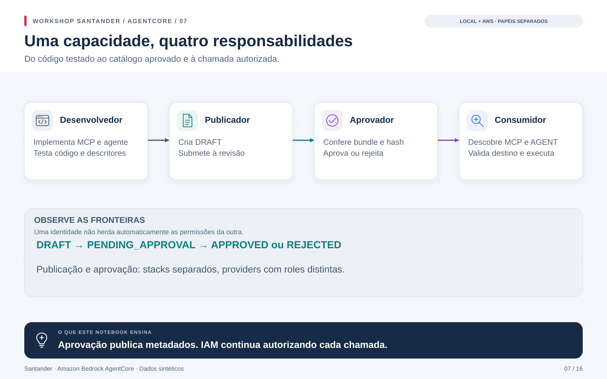
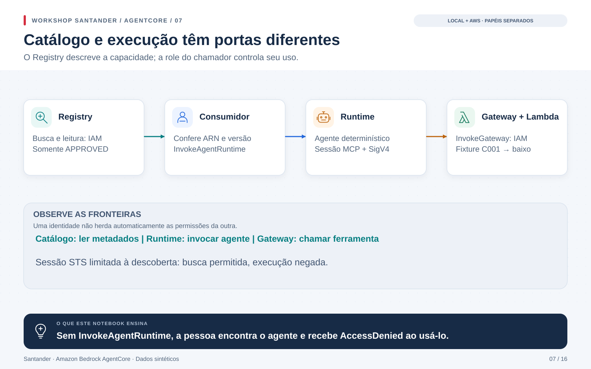

# Do desenvolvimento ao consumo de capacidades

O [notebook 07](../../notebooks/07_registry_personas.ipynb) acompanha a mesma
entrega pelas quatro personas: desenvolvedor, publicador, aprovador e consumidor.
Ele vem depois dos estados do catálogo, no 06, e antes da composição por
descoberta, no 08. A numeração dos 17 notebooks acompanha a jornada de aprendizado.



## O que será construído

Um servidor MCP anuncia `risco___consultar_risco`. A ferramenta aceita somente
os clientes sintéticos `C001` e `C002`. Um agente determinístico consulta essa
ferramenta e produz uma frase com o resultado; este exercício não usa um LLM.

Na AWS, o agente roda no AgentCore Runtime, chama o Gateway por MCP/SigV4 e
recebe o resultado de uma Lambda. O Registry contém dois registros:

| Tipo | Conteúdo | Quem executa |
|---|---|---|
| MCP | Endpoint, transporte e schema da ferramenta | Gateway → Lambda |
| AGENT | ARN do Runtime, HTTP, IAM e dependência do MCP | Runtime → Gateway |

O registro AGENT usa um descritor `custom`, aceito pelo serviço. Ele não é
um AgentCard A2A: o endpoint implementa a interface HTTP do Runtime.
O catálogo guarda metadados; o ZIP do código pertence ao pipeline de infraestrutura.

## Papéis e estados

O desenvolvedor entrega código e descritores testados. O publicador cria
`DRAFT` e submete para `PENDING_APPROVAL`. O aprovador decide `APPROVED` ou
`REJECTED`. O consumidor só encontra registros aprovados, mas ainda precisa
de permissão no destino para executá-los.



As roles Publisher e Approver são também as roles de execução de **funções
Lambda distintas**, invocadas pelos custom resources CloudFormation. Cada
função recusa recursos que pertencem à outra fase. O notebook usa sessões STS
para leituras e consumo; nenhuma célula chama APIs de escrita diretamente.

O perfil do operador orquestra todas as fases na conta de laboratório. Isso
não implementa quatro logins humanos ou uma aprovação corporativa independente.
Para uso em equipe, restrinja também quem pode acionar cada fase, alterar o
IaC e passar roles ao serviço de CI/CD. O operador administrador pode alterar
as próprias permissões da bancada.

O hash SHA-256 vincula uma aprovação ao bundle revisado. Ele não substitui
assinatura de artefatos, revisão do código, teste de comportamento ou autorização.
A imutabilidade de versões e a exigência de PENDING_APPROVAL para decidir são
escolhas deste exercício; a API oferece outros fluxos de edição e revisão.

## Preparação local

Na raiz do repositório:

```bash
uv sync --frozen --extra banking
uv run pytest tests/test_registry_workflow.py -q
uv run python -m scripts.generate_registry_notebook
```

Abra o notebook 07 e selecione o kernel `.venv/bin/python`. `Run All` executa
o contrato local, com `RUN_AWS=False` e `RUN_PIPELINE=False`. A bancada verifica
separação de papéis, rascunhos ocultos, aprovação, rejeição, hash divergente,
destino não confiável e execução sem permissão. Isso não é uma prova IAM.

## Implantação em uma conta

Perfil `default`, região `us-east-1`. O ambiente é independente do Entra,
do Terraform do notebook 09 e dos stacks compartilhados dos notebooks 06 e 08.
A API atual usa `agent-registry-control` para controle e `agent-registry`
para descoberta. Use o `uv.lock` do projeto para obter um SDK compatível.

```bash
uv run python -m infra.registry_workflow.generate
uv run cfn-lint infra/registry_workflow/templates/*.json
uv run python scripts/build_artifacts.py --banking
uv run python scripts/registry_deploy.py bootstrap
uv run python scripts/registry_deploy.py bootstrap --execute
uv run python scripts/registry_deploy.py foundation
uv run python scripts/registry_deploy.py foundation --execute
```

Sem `--execute`, revise o change set criado pelo wrapper. A fase `foundation`
também envia o artefato por hash ao bucket privado; não publique o ZIP manualmente.
O Runtime e o Gateway têm endpoints gerenciados públicos protegidos por IAM.
O bucket bloqueia acesso público e exige TLS.

Depois execute cada fase, conferindo seus estados no notebook:

```bash
uv run python scripts/registry_deploy.py publish
uv run python scripts/registry_deploy.py publish --execute
uv run python scripts/registry_deploy.py submit
uv run python scripts/registry_deploy.py submit --execute
```

A publicação gera `build/registry-bundle.json` e um candidato a revisão.
Leia o bundle e os testes; só então prepare `build/registry-review.json` a partir
de `build/registry-review-candidate.json`, com os digests conferidos e as decisões.
Para seguir até a execução, aprove MCP e AGENT:

```bash
uv run python scripts/registry_deploy.py approve --review build/registry-review.json
uv run python scripts/registry_deploy.py approve --review build/registry-review.json --execute
uv run python scripts/registry_check.py --live
```

O provider lê novamente o conteúdo e compara o hash antes de mudar o status.
O teste final espera a indexação, descobre o agente e executa a chamada. Também
assume uma sessão Consumer limitada à descoberta e exige uma negativa real de
`InvokeAgentRuntime`. `SimulatePrincipalPolicy` verifica a matriz de ações sem
executar escritas proibidas; não equivale a testar todos os efeitos de SCPs.

As fases usam nomes próprios com prefixo `registry-personas`. Para várias
bancadas na mesma conta, passe outro `--prefix` em **todos** os comandos.
O wrapper publica a versão 1.0.0 deste exemplo. O exercício de versão rejeitada
1.1.0 é local; não há migração automática de revisão/versionamento na AWS.

## Leitura dos resultados

Ao executar o ciclo completo, confira que MCP e AGENT ficam ocultos em DRAFT
e PENDING_APPROVAL e aparecem para o consumidor após APPROVED. Uma sessão
limitada à descoberta deve conseguir encontrar o agente e receber negativa
ao invocá-lo. Runtime e Gateway devem recusar chamadas anônimas.

A matriz IAM compara 16 decisões entre as quatro personas usando simulação
de políticas; isso é diferente de tentar escritas reais com cada papel.
Os casos de versão rejeitada e hash alterado são exercícios locais.

`LOCAL_CONTRACT` comprova o modelo em memória. `AWS_LIVE/PASS` só é emitido por
`registry_check.py` depois da execução real e das verificações. O relatório
sanitizado fica em `evidence/registry-personas.json`, ignorado no Git.

Esse comando verifica o consumo de um ambiente já aprovado; não repete as
transições DRAFT → PENDING_APPROVAL → APPROVED. Para acompanhá-las, execute o
notebook durante as fases de publicação, submissão e aprovação pelo IaC.
As roles dos providers são distintas; o operador do sandbox orquestra o pipeline.

O consumidor compara ARN, Gateway, tipo, versão e descritor com a configuração
esperada. A listagem trata paginação, inclusive páginas vazias; o batch recusa
erros parciais. A aprovação não converte URLs arbitrárias em destinos confiáveis.

Busca e listagem são autorizadas no nível do Registry e podem revelar todos
os metadados aprovados nele. Uma negativa de `GetDiscoverableRegistryRecord`
por registro não garante que ele ficará oculto na busca.

## Recuperação de um Create cancelado

O Runtime depende da conclusão do Registry para reduzir cancelamentos
concorrentes durante a criação. Se uma versão anterior do IaC tiver deixado
um catálogo após um rollback, `scripts/registry_recover.py` oferece um plano
de reconciliação. Ele exige stack vazio em `ROLLBACK_COMPLETE`, sem proteção
de término, e identifica o catálogo pelo nome derivado do token da criação
original. Nenhum recurso alheio àquela tentativa é selecionado.

Sem `--execute`, o script só lê e apresenta o plano. Com `--execute`, ele
remove o stack vazio e reaplica `foundation` com o ARN recuperado no template.
A recuperação passa pelo mesmo provider e preserva o ARN nos próximos deploys;
não usa import ou mutações avulsas nas APIs do Registry. O procedimento é
específico para o template inicial reconhecido pelo script; outros erros
devem ser diagnosticados e corrigidos no IaC.

## Limpeza

Remova na ordem **approve → submit → publish → foundation → bootstrap**.
Use `scripts/cleanup.py --scenario registry_workflow` com o template e o nome
real do stack, perfil, conta e região. O comando sem `--execute` confere o
template e mostra o ARN. Após revisar, use `--execute --confirm-stack-id ARN`.

Excluir o recurso de aprovação não desfaz uma aprovação existente. Excluir
`publish` remove os registros; `foundation` remove Registry, Runtime, Gateway,
Lambda e roles. O bucket versionado de artefatos usa `Retain` e mantém custos.
A service-linked role do serviço também não é removida pelo workshop.
Não desative proteções nem apague recursos com comandos fora do IaC.

## Documentação oficial

- [Tipos de registros e descritores](https://docs.aws.amazon.com/bedrock-agentcore/latest/devguide/registry-supported-record-types.html)
- [Criação e manutenção de registros](https://docs.aws.amazon.com/bedrock-agentcore/latest/devguide/registry-create-manage-records.html)
- [Estados, versões e revisões](https://docs.aws.amazon.com/bedrock-agentcore/latest/devguide/registry-record-lifecycle.html)
- [Revisão e aprovação](https://docs.aws.amazon.com/bedrock-agentcore/latest/devguide/registry-reviewing-records.html)
- [Permissões de controle e descoberta](https://docs.aws.amazon.com/bedrock-agentcore/latest/devguide/registry-iam-permissions.html)
- [Migração do namespace preview, com descontinuação anunciada para 30/10/2026](https://docs.aws.amazon.com/bedrock-agentcore/latest/devguide/registry-faq.html)
- [IAM: políticas de sessão](https://docs.aws.amazon.com/IAM/latest/UserGuide/access_policies.html#policies_session)
- [Custom resources CloudFormation](https://docs.aws.amazon.com/AWSCloudFormation/latest/UserGuide/template-custom-resources.html)
