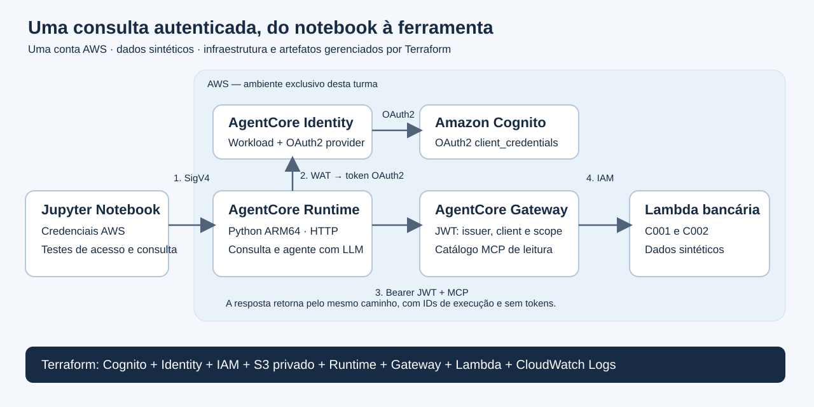

# Laboratório 09 — a primeira implantação com Terraform

Depois de estudar ferramentas, identidade, Policy e descoberta, vamos implantar
um caminho completo em **uma conta AWS**. O exercício usa Runtime, Gateway e
Identity, com Cognito e uma Lambda de consulta. Ele prepara o participante para
os cenários multi-conta que vêm em seguida na [jornada](../jornada.md).

[Abrir notebook 09](../../notebooks/09_terraform_runtime_gateway_identity.ipynb) ·
[Configuração de exemplo](../../config/terraform.example.json)



## Acompanhar a chamada

1. O notebook invoca o Runtime HTTP com credenciais IAM e assinatura SigV4.
2. O Runtime obtém um workload access token (WAT) para a identidade declarada
   no Terraform e solicita uma credencial OAuth M2M ao AgentCore Identity.
3. Identity usa o cliente Cognito registrado no credential provider para obter
   um token `client_credentials`.
4. O Gateway verifica o JWT, o cliente e o scope e oferece a ferramenta
   `banking___get_customer_profile` pelo protocolo MCP.
5. A role do Gateway invoca a Lambda, que consulta os clientes sintéticos.

A primeira consulta é determinística. Depois, um modelo Bedrock usa a mesma
ferramenta; o teste exige uma chamada efetiva antes de aceitar a resposta.
O modelo padrão é `amazon.nova-lite-v1:0`.

Este cenário ensina **identidade de aplicação**. C001 e C002 são registros de
clientes sintéticos, não identidades autenticadas. O Terraform não cria uma
engine Cedar nem implementa OBO humano. Esses controles foram introduzidos nos
módulos conceituais e voltam nos [cenários por usuário](../federation/README.md).

## Ler a implementação

| Fonte | Responsabilidade |
|---|---|
| [infra/terraform_agentcore](../../infra/terraform_agentcore/) | Recursos, roles, providers e outputs |
| [requirements.lock](../../infra/terraform_agentcore/requirements.lock) | Dependências Linux ARM64 com hashes |
| [backend.py](../../src/santander_demo/terraform_lab/backend.py) | Ferramenta Lambda de consulta |
| [runtime.py](../../src/santander_demo/terraform_lab/runtime.py) | Identity, MCP e ciclo de tool use |
| [client.py](../../src/santander_demo/terraform_lab/client.py) | Verificações reais da integração |
| [terraform_deploy.py](../../scripts/terraform_deploy.py) | Pipeline de plan, apply, outputs, drift e destroy |

O Runtime usa Python 3.12 empacotado em ZIP; o exercício não depende de Docker,
ECR ou CodeBuild. S3 é privado, criptografado, versionado e exige TLS. As roles
separam execução do Runtime, invocação da Lambda e escrita de logs.

## Preparar e planejar

Use Python 3.12 ou 3.13, `uv`, Terraform >=1.11 e <2 e uma conta de laboratório.
O provider AWS está fixado em 6.70.0. O deploy de referência usa perfil `default`
e `us-east-1`; confirme a conta esperada na configuração local.

```bash
uv sync --frozen --extra banking
cp config/terraform.example.json config/local.terraform.json
```

Preencha `profile`, `region`, `expected_account_id` e `project_name`. A conta é
verificada por STS e por `allowed_account_ids` no provider. O wrapper impede
que credenciais de ambiente sobreponham o perfil escolhido.

```bash
uv run --frozen --extra banking python scripts/terraform_build.py
uv run --frozen --extra banking python scripts/terraform_deploy.py init
uv run --frozen --extra banking python scripts/terraform_deploy.py validate
uv run --frozen --extra banking python scripts/terraform_deploy.py preflight
uv run --frozen --extra banking python scripts/terraform_deploy.py plan
```

O principal de implantação precisa gerenciar os recursos declarados e passar
suas roles. Para os testes isolados, precisa também descrever o cliente Cognito,
invocar o Runtime, obter tokens Identity e acessar o segredo do provider.
Essas permissões do operador são distintas da role limitada usada pelo agente.

## Aplicar em duas fases

Revise a conta e os recursos do plano. Em seguida:

```bash
uv run --frozen --extra banking python scripts/terraform_deploy.py apply
uv run --frozen --extra banking python scripts/terraform_deploy.py plan
uv run --frozen --extra banking python scripts/terraform_deploy.py apply
```

A primeira fase cria 24 recursos. O Runtime cria seu grupo de logs usando o ID
atribuído pelo serviço. Na segunda fase, o wrapper detecta o Runtime no state e
habilita o bloco de importação declarativa desse grupo. O Terraform passa a
gerenciar sua retenção, tags e exclusão, totalizando 25 recursos no state.
O output `runtime_logs_managed` deve ser `true`.

`apply` consome o plano salvo e confere hashes de fontes, configuração e
artefatos. Mudanças exigem um novo plano. Não é necessário executar
`terraform import` manualmente ou corrigir recursos fora do pipeline.

## Testar e interpretar

```bash
uv run --frozen --extra banking python scripts/terraform_check.py --llm
uv run --frozen --extra banking python scripts/terraform_deploy.py drift
uv run --frozen --extra banking python scripts/terraform_notebook_check.py --live
```

O conjunto com LLM tem nove verificações: rejeições de autenticação, token de
outro cliente, descoberta MCP, erro sem perfil para C999, consultas C001/C002 pelo
Runtime e uso da ferramenta pelo modelo. O relatório sanitizado fica em
`evidence/terraform-agentcore-live.json`. A cópia executada do notebook fica em
`evidence/executed/`; `--live` não habilita deploy nem destruição.

O Gateway pode retornar um erro genérico para C999. Nesse caso,
`scope=ERROR_WITHOUT_PROFILE` e `cause=NOT_PROVEN` indicam que a causa não foi
identificada; não conte esse resultado como prova de recusa por permissão.
Para as consultas permitidas, confira os dados e correlacione os IDs da
resposta com os eventos `synthetic_tool_completed` da Lambda no CloudWatch.

Para verificar a implementação localmente:

```bash
uv run --frozen --extra banking pytest -q tests/test_terraform_lab.py
terraform -chdir=infra/terraform_agentcore test \
  -var='expected_account_id=123456789012' \
  -var="runtime_zip=$PWD/build/terraform-agentcore/runtime.zip" \
  -var="lambda_zip=$PWD/build/terraform-agentcore/lambda.zip"
```

O teste Terraform usa `mock_provider` e não cria recursos. Os testes Python
verificam também MCP sobre HTTP em memória. O [guia de validação](../validacao.md#laboratório-09)
explica o alcance dos testes e como conferir as evidências de cada execução.

## State, custos e encerramento

O state e o plano binário contêm o segredo Cognito, mesmo com campos `sensitive`.
O wrapper usa `umask 077`; state, planos e configuração local são ignorados pelo
Git. Não mostre `terraform show -json` durante a apresentação. Cada ambiente
precisa de state próprio; em equipe, configure um backend protegido antes do
primeiro apply. O exemplo não cria nem migra um backend remoto automaticamente.

Runtime, Gateway, Identity/Cognito M2M, Lambda, S3, logs e inferência têm custos
conforme uso e região. As sessões têm ociosidade máxima de 60 segundos e duração
máxima de 600 segundos; os logs têm retenção de sete dias.

Ao concluir, use `plan-destroy` e `destroy` pelo wrapper, seguindo a
[limpeza](../cleanup.md). O bucket de artefatos é exclusivo do exercício e sua
exclusão inclui todas as versões. Depois, avance para o
[notebook 10](../../notebooks/10_santander_multi_conta.ipynb) para distribuir
as responsabilidades entre contas.

## Aprofundar

- [State do Terraform](https://developer.hashicorp.com/terraform/language/state)
- [Importação declarativa](https://developer.hashicorp.com/terraform/language/import)
- [OAuth client_credentials no Cognito](https://docs.aws.amazon.com/cognito/latest/developerguide/token-endpoint.html)
- [Tokens de workload do Identity](https://docs.aws.amazon.com/bedrock-agentcore/latest/devguide/get-workload-access-token.html)
