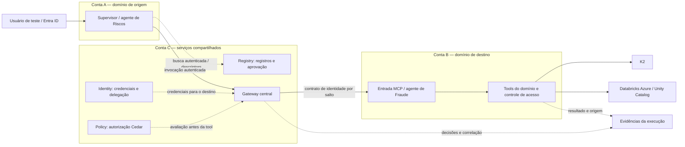

# Plano da demo e do workshop Santander — Identity, Policy, Gateway e Registry

**Adequações implementadas após a revisão (09/10/2026):** o
[notebook 12](notebooks/12_cenario_santander_integrado.ipynb) passa a ser o fluxo
principal: agentes hospedados na conta A → hub central → Gateway da conta B →
MCP Databricks, com Identity, Policy e Registry. Inclui testes por agente,
usuário, tool e SQL aprovado, além de preparação IaC e coleta de query IDs.
O ensaio cloud e a correlação completa dos logs continuam pendentes. Consulte
o [estado atualizado de cada demanda](docs/adequacoes-santander.md).

A [matriz de decisões](docs/journey/decisoes.md) responde à coexistência com
Databricks/Neural Trust e à divisão de QPM/TPM/budget. A Sessão 2 ganhou o
[notebook 13 de ingestão/ACL/memória](notebooks/13_ingestao_acl_memoria.ipynb),
executável localmente; [Harness ganhou roteiro próprio](docs/harness/sessao-online.md).
A agenda atual é o [roteiro consolidado](docs/roteiro.md). As seções originais
abaixo permanecem como detalhamento dos módulos e resultados esperados.

**Cenário adicional implementado:** [notebook 11 — um Gateway, Identity OBO e
Policy por conta](notebooks/11_gateways_por_conta_identity_policy.ipynb).
[Arquitetura e execução](docs/federation/README.md).

**Revisão:** 09/10/2026, com foco atualizado em Identity, Policy, Gateway e Registry.  
**Fontes do cliente:** [HTML de escopo](2026-10-05-AgentCore-casos-de-uso-Santander.html) e [conversa](conversa.md).  
**Referência de implementação:** notebooks de [awslabs/agentcore-samples](https://github.com/awslabs/agentcore-samples), no commit `2747451473d1fadbba18f5aee0524e533e3c2b2e`, de 08/10/2026.  
**Catálogo das referências:** [notebooks selecionados, seções úteis e adaptações](referencias-notebooks-agentcore.md).  
**Status:** quatorze notebooks preparados: 00–09 simulação local, 10–12 preparação offline e 13 contrato local de ingestão/ACL. Código, testes, templates IaC e instruções estão no [README](README.md). A execução em AWS, Entra e Databricks está pendente de ambiente e dos [critérios de aceite](docs/aceite.md). A extensão 12 usa também o sample Databricks native OBO no commit `f33b4f14ea46cae2379196948073a6bb4d0e21cf`. Resultados esperados não equivalem a integrações já comprovadas.

## 1. Direção da demo

Preparar uma história única: **um usuário pede uma análise; o supervisor descobre capacidades aprovadas, chama agentes e tools autorizados e acessa uma fonte em nome desse usuário**. O público acompanha quem está chamando, qual regra permite ou nega a ação e como a identidade chega ao destino.

Os quatro pilares respondem a perguntas distintas:

| Pilar | Pergunta que a demo responde | Prova ao vivo |
|---|---|---|
| **Identity** | Quem é o usuário, quem é o agente/aplicação e com qual credencial cada serviço é acessado? | Comparar M2M, consentimento delegado e OBO; trocar usuário e verificar a identidade no destino. |
| **Policy** | Esse principal pode chamar esta tool com estes parâmetros? | Política Cedar aplicada no Gateway, com chamadas permitidas e negadas por identidade, ação e entrada. |
| **Gateway** | Como expor e invocar tools e agentes por um contrato MCP, autenticando entrada e saída? | Um target Lambda simples e um target MCP, descoberta de tools e invocação controlada. |
| **Registry** | Quais capacidades estão publicadas, aprovadas e disponíveis para descoberta? | Publisher → aprovação → busca → descoberta durante a execução, com separação de papéis. |

**Identity e Policy receberão a maior parte do tempo.** Gateway conecta os exercícios e aplica o controle na invocação. Registry terá um bloco próprio de governança e descoberta, integrado ao fluxo final.

Runtime será a hospedagem dos agentes; observabilidade será a evidência transversal. K2, Databricks, Entra ID e a arquitetura entre contas continuam sendo o contexto Santander. Ingestão, AWS Context, Memory e Harness ficam nas frentes complementares do escopo original.

### Enredo de negócio

Usar o cliente fictício `SANT-DEMO-001` e dados sintéticos. A solicitação será: “Consulte o risco deste cliente e, se eu tiver acesso, complemente com os indícios de fraude”.

- **Supervisor:** descobre capacidades e delega aos especialistas permitidos.
- **Agente de Riscos:** chama `consultar_risco` e `consultar_conhecimento_k2` quando autorizado.
- **Agente de Fraude:** chama `consultar_fraude` quando autorizado.
- **Usuário Riscos:** possui acesso apenas ao domínio de Riscos.
- **Usuário Riscos + Fraude:** pode receber a análise combinada.
- **Usuário sem grant na fonte:** pode entrar na aplicação, mas não consultar aquele conjunto de dados.

Esses perfis são propostos para o laboratório. A alocação de Riscos/Fraude a Retail Banking e Transaction Banking, citados na conversa, deve ser alinhada com o cliente.

## 2. Notebooks de referência e ordem de adaptação

Os identificadores abaixo apontam para o [catálogo com links diretos e commit fixado](referencias-notebooks-agentcore.md). Os arquivos Santander estão em [notebooks/](notebooks/); os arquivos da AWS são referências adaptadas. Diferenças e limites da implementação estão no [README](README.md).

| Notebook Santander planejado | Bases AWS | Conteúdo a reaproveitar | Resultado esperado |
|---|---|---|---|
| `00_preflight.ipynb` | Pré-requisitos de I5, P1/P3 e R1/R2 | Verificações de região, SDK, recursos prontos, authorizers e acesso. | Ambiente conhecido, com ARNs/endpoints obtidos do deploy IaC. |
| `01_gateway_targets.ipynb` | **G1 + G2**; I2 para Entra inbound | Schema Lambda, target MCP, credential provider, `tools/list` e `tools/call`. | Duas capacidades sintéticas expostas e chamadas pelo Gateway. |
| `02_identity_entra_obo.ipynb` | **I5 principal**; I1/I2 como comparação e I3 como complemento | Entra inbound, fluxo de usuário, provider OBO, target com `TOKEN_EXCHANGE`. | Perfil do usuário correto no Microsoft Graph `/me`, com audiência de origem e destino explicadas. |
| `03_identity_agente_mcp.ipynb` | **I4** | Agente em Runtime, MCP separado, autenticação técnica do transporte e delegação do usuário. | Explicar e verificar as duas identidades presentes na chamada entre serviços. |
| `04_policy_cedar.ipynb` | **P1 + P3** | Policy Engine associado ao Gateway, `ENFORCE`, claims, ações específicas e condições de entrada. | Matriz de permissões de Riscos/Fraude comprovada por chamadas MCP determinísticas. |
| `05_policy_autoria.ipynb` | **P2** | Requisito em linguagem natural → Cedar → findings → revisão e testes. | Política compreendida e validada antes de sua promoção pelo IaC. |
| `06_registry_governanca.ipynb` | **R1 + R2** | Papéis de publicação/aprovação/consumo; estados dos registros; busca autenticada. | Catálogo governado e autenticação da busca verificadas. |
| `07_registry_descoberta_execucao.ipynb` | **R3**, com R4 como complemento | Pesquisa, leitura dos descriptors, conexão ao endpoint e chamada. | O supervisor descobre uma capacidade aprovada; o Gateway ainda aplica Policy à execução. |
| `08_santander_multi_conta.ipynb` | **G5 + I4/I5 + P3 + R3** | Composição dos padrões anteriores. | Conta A → hub C → domínio B, com identidade, autorização e evidências por fronteira. |
| `09_databricks_e_evidencias.ipynb` | **D1 + D2 + G6**, com referência adicional de troca nativa | Prova isolada por SQL REST, delegação e exportação de evidências. O caminho MCP pelo Gateway está no notebook 12. | Verificar o usuário no Databricks e o grant aplicado; registrar a cobertura efetivamente validada. |

**Ordem de desenvolvimento:** Gateway mínimo → Identity/OBO → Policy com claims reais → Registry → composição entre contas → Databricks. A validação do Databricks/Azure deve começar cedo como investigação independente, sem bloquear a construção dos quatro módulos centrais.

Não é necessário executar integralmente cada notebook original durante o evento. Consolidar suas partes relevantes em exercícios curtos que reutilizem o mesmo ambiente.

## 3. Identity — módulo principal

### 3.1 Ensinar os três fluxos com precisão

| Fluxo | Referência | O que demonstrar | Adaptação Santander |
|---|---|---|---|
| **M2M / client credentials** | I1 e I2 | Token de aplicação autenticando acesso a Runtime/Gateway. | Usar como comparação didática com identidade de usuário. O código de I1 chama `acquire_token_for_client`; I2 solicita `client_credentials`. |
| **Delegação com consentimento / 3LO** | I3 | Credential provider, `USER_FEDERATION`, callback e consentimento. | Reduzir a integração ao perfil de teste. O original cria conteúdo no OneNote e pede permissões de escrita. |
| **OBO no Gateway** | I5 | JWT do usuário → validação inbound → troca para credencial do destino → chamada ao Graph. | Usar `/me` com contas de teste. É a base mais direta para colocar Identity e Gateway no centro da explicação. |
| **OBO no agente com MCP separado** | I4 | Identidade técnica do chamador no transporte MCP e token delegado para a API final. | Evoluir para a chamada entre serviços/domínios. O exemplo é referência de autenticação; a ampliação para contas distintas exige validação própria. |

**Ponto que precisa ficar claro:** conseguir um token ou executar uma chamada autenticada não demonstra, por si só, que o usuário humano foi preservado até a fonte.

### 3.2 Exercícios

1. Identificar `iss`, `aud`, validade e permissões nos tokens, exibindo somente claims sanitizadas.
2. Entrar como usuário A e chamar `/me`; repetir como B e observar a mudança de identidade no resultado.
3. Comparar o token para a aplicação de entrada com a credencial do destino após OBO.
4. Mostrar quem é a aplicação/agente atuante em cada salto, conforme as claims efetivamente emitidas.
5. Repetir uma chamada com token expirado ou audiência incorreta e observar a recusa.
6. No fluxo I4, mostrar o token técnico que autentica o transporte e a credencial delegada que a tool usa no destino.
7. Testar ausência de delegação: a chamada deve falhar, sem usar uma credencial compartilhada mais privilegiada.

I4 usa provider Microsoft e troca no agente; I5 configura provider customizado e troca no Gateway. São implementações distintas. Validar suas configurações separadamente antes de compor a arquitetura.

### 3.3 Contrato de identidade que precisa ser fechado

| Fronteira | Contrato a preencher |
|---|---|
| Usuário → supervisor | Emissor, audiência, usuário, aplicação cliente, escopos e vínculo com a sessão. |
| Supervisor → Registry | Mecanismo de autenticação da busca e credencial destinada ao Registry. |
| Supervisor/agente → Gateway | Usuário e identidade técnica verificáveis; claims disponíveis para Policy. |
| Gateway central → domínio remoto | Credencial aceita pelo destino e mecanismo que preserva o contexto delegado necessário. |
| Tool → Graph/Databricks/K2 | Principal efetivamente reconhecido pelo destino e permissões aplicadas. |

Para Entra, verificar a correlação do usuário no escopo do tenant, como `tid` + `oid`, e a representação da aplicação chamadora, como `appid`/`azp`, quando presentes. Não assumir que o `sub` de Cognito M2M tem o mesmo significado no fluxo Entra delegado.

**Dependência crítica da composição com Policy:** confirmar quais claims chegam como atributos do principal ao mecanismo de autorização. Se diferentes agentes compartilham a mesma identidade técnica, a política pode não distingui-los. Resolver esse contrato antes de prometer controle individual por agente.

## 4. Policy — transformar o escopo em regras verificáveis

### 4.1 Base técnica

- **P1:** associar Policy Engine ao Gateway, usar `ENFORCE` e condicionar uma ação aos parâmetros da tool.
- **P3:** combinar atributos do principal, ação específica, recurso e dados de entrada; testar cenários permitidos e negados.
- **P2:** gerar Cedar a partir de linguagem natural, inspecionar findings e preparar uma versão revisada para implantação.

O original P3 usa **Cognito M2M com claims inseridas por trigger**. Para Santander, adaptar ao contrato real do Entra e comprovar o mapeamento para os atributos consumidos pela política. Não executar a função de “correção” de authorizer de P3 sobre o Gateway Entra: ela foi escrita para reconfigurá-lo como Cognito.

### 4.2 Regras propostas para o laboratório

| Regra | Intenção da política | Teste de aceite |
|---|---|---|
| P-SAN-01 | Somente chamadores técnicos autorizados e usuários do domínio Riscos podem usar `consultar_risco`. | Mesmo usuário, agente correto: permite; agente não autorizado: nega. |
| P-SAN-02 | `consultar_fraude` exige permissão do usuário e do agente/supervisor que a invoca. | Usuário Riscos: nega; usuário Riscos + Fraude com chamador autorizado: permite. |
| P-SAN-03 | Limitar `max_registros` da consulta sintética a 50. | 50 permite, 51 nega, parâmetro obrigatório ausente produz recusa de schema ou política identificada. |
| P-SAN-04 | Restringir a ação ao Gateway/target e à tool específicos. | Uma tool diferente não recebe permissão por um `permit` excessivamente amplo. |
| P-SAN-05 | Ausência de atributo obrigatório não satisfaz a autorização. | Token válido sem o atributo necessário é recusado. |
| P-SAN-06 | O supervisor pode delegar ao especialista previsto; o agente de Riscos não recebe automaticamente a mesma permissão. | Delegação prevista permite; chamada direta indevida à capacidade de Fraude nega. |

As condições de identidade e parâmetros devem ser compostas corretamente. Vários `permit` independentes podem autorizar caminhos alternativos; não separar “grupo autorizado” e “limite de registros” em regras que acabem permitindo qualquer uma das condições isoladamente.

Os valores e perfis acima são didáticos. `max_registros` limita o parâmetro de uma chamada; QPM, TPM e orçamento mensal são requisitos diferentes.

### 4.3 Como apresentar

1. Mostrar a política Cedar associada à tool e o modo efetivo do Policy Engine.
2. Executar chamadas MCP com parâmetros fixos para produzir evidência determinística.
3. Comparar a mesma chamada mudando somente usuário, identidade técnica ou parâmetro.
4. Inspecionar a recusa e confirmar, por contador/log sanitizado do backend, que a tool negada não executou.
5. Repetir por meio do agente para demonstrar que o controle se mantém durante a orquestração.
6. Mostrar uma versão revisada da regra e seu processo de promoção pelo pipeline.
7. No exercício de autoria, comparar a intenção em português com o Cedar gerado e com a matriz de testes.

A demo principal usa **`ENFORCE`**. `LOG_ONLY` pode ser explicado com evidências de um ambiente de teste separado, pré-configurado por IaC. A comprovação de bloqueio deve ser feita no modo que efetivamente bloqueia.

### 4.4 Ajustes necessários nos exemplos

- Remover o fallback `IGNORE_ALL_FINDINGS` presente em P1/P2; corrigir e revisar os findings antes de promover a política.
- Substituir correspondências amplas como `like "*admins*"` por uma representação de autorização inequívoca, validada para o IdP escolhido. Testar grupos/roles de nomes semelhantes.
- Usar claims de origem confiável. Parâmetros de tool como `department`, `agent_name` ou `approval=true` enviados pelo cliente não comprovam identidade ou aprovação.
- Confirmar negação sem `permit` aplicável em `ENFORCE`. P1 contém texto contraditório sobre engine vazio; os testes precisam resolver a interpretação.
- Separar a recusa de autenticação, a recusa Cedar, a validação de schema e a recusa da fonte de dados.

A autorização das tools será demonstrada com **AgentCore Policy**. O acesso administrativo ao Registry será governado por IAM; os grants sobre dados continuarão sob responsabilidade da fonte, como Unity Catalog.

## 5. Gateway — ligação entre identidade, política e execução

### Conteúdo obrigatório

1. **Target Lambda:** schema simples para `consultar_risco`, baseado em G1, usando resposta sintética previsível.
2. **Target MCP:** registrar a capacidade de um especialista/servidor existente, baseado em G2.
3. **Inbound:** autenticação Entra, com configuração adequada ao token realmente emitido.
4. **Outbound:** explicar a credencial escolhida para cada target: IAM, aplicação OAuth ou delegação do usuário.
5. **Policy:** associar a autorização Cedar às chamadas de tools.
6. **Chamada:** executar `tools/list` e depois `tools/call`, observando o nome qualificado real da tool.

G2 usa nomes no formato `{targetName}___{toolName}`. A ação usada em Cedar deve corresponder ao nome efetivamente exposto, sem adivinhar prefixos.

**Busca no Gateway e busca no Registry:** G8 demonstra seleção de tools dentro de um Gateway; R1/R3 demonstram descoberta de capacidades publicadas no catálogo. A demo pode mostrar ambas, explicando o papel de cada uma. Não é necessário reproduzir as centenas de tools ou o benchmark de latência de G8.

Para os especialistas, G5 é referência de supervisor com Gateway central e agentes como tools. Seu exemplo usa interceptor e credenciais M2M em parte do caminho. Reaproveitar o padrão de composição, adaptando autorização para Policy e validando delegação em cada fronteira.

## 6. Registry — governança, descoberta e invocação

### 6.1 Papéis e ciclo do registro

Usar R1 como referência principal e R2 para busca autenticada.

| Papel | Responsabilidade | Prova |
|---|---|---|
| Publisher do domínio | Publicar descriptor/versionamento e submeter para revisão. | Não consegue aprovar a própria publicação. |
| Administrador/aprovador | Revisar e aprovar ou rejeitar registros. | Registro percorre `DRAFT → PENDING_APPROVAL → APPROVED` ou `REJECTED`. |
| Consumidor/supervisor | Buscar e ler capacidades permitidas ao seu papel. | Não consegue criar ou aprovar registros. |

Manter `autoApproval: false`. Os estados e o workflow serão preparados pelo mecanismo de implantação/governança autorizado do projeto. No workshop, os notebooks podem consultar estados já preparados e consumir registros; mudanças seguem o pipeline definido na seção 11.

Criar registros de Riscos, Fraude e acesso ao K2 com descrição de negócio, protocolo, schema, versão, proprietário e localização. Definir onde cada metadado cabe no modelo suportado. Publicar endpoints que conduzam ao caminho de autorização previsto.

### 6.2 Descoberta durante a execução

Adaptar R3, trocando o caso de pedidos/e-commerce pelo caso Santander:

1. Supervisor recebe a pergunta de negócio.
2. Pesquisa capacidades no Registry.
3. Inspeciona o descriptor retornado e seleciona a versão/endpoint aprovado.
4. Autentica a chamada ao Gateway/serviço correspondente.
5. Gateway aplica Policy antes da invocação.
6. Agente/tool executa e retorna resultado com evidências.

**Teste central:** um registro aprovado e encontrado na busca ainda pode ter sua execução negada pela política aplicável ao chamador. Aprovação para descoberta e autorização de uso são verificadas em etapas diferentes.

R4 complementa a publicação com sincronização de metadados a partir de MCP protegido por OAuth ou IAM. A sincronização usa uma credencial de descoberta; seu resultado não comprova delegação por usuário durante a execução.

### 6.3 Adaptações a fazer

- R1 cria usuários IAM e chaves. Substituir por papéis/sessões temporárias separados e previamente provisionados.
- R2 usa Cognito para busca OAuth. A variante com Entra depende de validar as opções do authorizer e o token aceito; não é uma equivalência já comprovada pelo notebook.
- O Registry de R2 escolhe um tipo de autenticação de busca. Não presumir suporte simultâneo a IAM e JWT na mesma configuração.
- Reservar tempo de preparação para propagação do índice; R3 documenta consistência eventual após aprovação.
- Transformar verificações de sucesso em asserções reais. R2 imprime uma mensagem final de sucesso mesmo sem impor uma asserção para todos os códigos HTTP.
- A2A aparece em R3, mas o núcleo Santander pode usar especialistas expostos por MCP. Se A2A entrar, documentar o ponto de autorização desse caminho; a associação de Policy ao Gateway não cobre automaticamente chamadas diretas a outros endpoints.

## 7. Arquitetura integrada para Santander

O desenho representa responsabilidades; a localização dos credential providers e dos controles de cada domínio depende dos escopos efetivamente suportados. Não pressupõe um provider de Identity compartilhado automaticamente entre contas.

A entrada e a saída de cada fronteira devem ter audiência, credencial e autorização definidas. A política do hub governa suas tools; os serviços do domínio remoto precisam manter seus próprios controles de entrada e de acesso aos dados.

**Condições da demonstração entre contas:**

- Executar realmente em contas distintas e exibir identificadores sanitizados para comprovar a separação.
- Demonstrar um caminho permitido e um caminho entre domínios recusado.
- Correlacionar o usuário e a identidade técnica de cada chamador.
- Verificar que a descoberta no Registry não oferece um atalho para contornar o Gateway/política previstos.
- Medir a fronteira que o trace alcança e apontar os sistemas ainda sem instrumentação.

G7 cobre conectividade entre contas com API privada, VPC Lattice e RAM. Ele usa API key e não comprova o fluxo de usuário, a federação de Registry ou OBO entre agentes. Só entra se a topologia de rede exigir esse padrão.

## 8. Demo integrada — roteiro de aproximadamente 30 minutos

| Minutos | Ação | Evidência |
|---|---|---|
| 0–4 | Login Entra e apresentação das identidades. | Usuário autenticado; audiência e chamador identificados. |
| 4–8 | Buscar “análise de risco e fraude” no Registry. | Registros aprovados, versão e endpoint encontrados. |
| 8–13 | Executar consulta de Riscos pelo Gateway. | Política permite; tool executa e retorna dado sintético. |
| 13–18 | Trocar uma condição: agente, grupo/role ou `max_registros`. | Policy nega; backend não executa a tool bloqueada. |
| 18–23 | Usuário autorizado aciona o especialista de Fraude na outra conta. | Hub e domínio remoto verificam o acesso; correlação entre contas. |
| 23–27 | Verificar o usuário no destino delegado. | Graph `/me` como prova básica; Databricks como extensão validada para o cliente. |
| 27–30 | Mostrar aprovação no catálogo versus autorização de execução e reconstruir o caminho. | Uma narrativa coerente com os quatro pilares. |

O módulo Graph isola e demonstra OBO com a base I5. Para declarar atendido o requisito Santander sobre BDAGs, é necessária a prova adicional em **Databricks/Azure**, com principal correto e grants distintos entre usuários.

## 9. Agenda proposta — workshop principal de 4h

| Horário relativo | Bloco | Base |
|---|---|---|
| 00:00–00:10 | Caso Santander e relação entre os quatro pilares | HTML e conversa |
| 00:10–00:30 | Gateway: schemas, targets e entrada/saída | G1, G2, I2 |
| 00:30–01:25 | Identity: M2M, usuário delegado, OBO e chamada a MCP | I5, I4; comparação com I1/I3 |
| 01:25–01:40 | Intervalo | — |
| 01:40–02:40 | Policy: Cedar, atributos, parâmetros, negações e autoria | P1, P3, P2 |
| 02:40–03:25 | Registry: publicação/aprovação, busca e descoberta em execução | R1, R2, R3 |
| 03:25–03:50 | Trecho integrado entre contas e evidência no destino | G5 e composição dos módulos |
| 03:50–04:00 | Decisões, lacunas e próximo piloto | Matriz de aceite |

A demo de 30 minutos também pode ser apresentada isoladamente. No workshop completo, parte dela já aparece nos exercícios; o bloco final de 25 minutos concentra a composição e evita repetir a introdução.

## 10. Preparação e entregáveis

### Sequência de trabalho

| Etapa | Trabalho | Saída verificável |
|---|---|---|
| 1. Fixar referências e ambiente | Usar o commit registrado, revisar dependências e selecionar conta/região e tenant de teste. | Manifesto de versões, acessos e recursos necessários. |
| 2. Montar Gateway mínimo | Target Lambda sintético e target MCP, com schemas estáveis. | `tools/list` e `tools/call` funcionando no ambiente de laboratório. |
| 3. Fechar Identity | Login de dois usuários, OBO com I5 e separação de identidades com I4. | Provas de usuário correto, token inválido e ausência de delegação. |
| 4. Compor Identity + Policy | Mapear claims reais do Entra para a política e implementar a matriz P-SAN. | Testes determinísticos aprovados, incluindo casos negativos. |
| 5. Compor Registry | Papéis, estados, busca autenticada e descriptors para os endpoints protegidos. | Publicação governada e descoberta seguida de execução autorizada/negada. |
| 6. Expandir para contas distintas | Aplicar os contratos de confiança e testar cada fronteira. | Fluxo A → C → B comprovado, sem perder os controles. |
| 7. Validar Databricks/Azure | Conectividade, troca delegada, principal e grants reais. | Evidência específica do requisito BDAG/Unity Catalog. |
| 8. Ensaiar e empacotar | Notebooks curtos, roteiro, gravação, reset e evidências sanitizadas. | Execução repetível para apresentador e participantes. |

**Estimativa preliminar:** 6–10 dias úteis de engenharia para o núcleo dos quatro pilares, com acessos disponíveis. Estimar a expansão entre contas e a integração Databricks após as provas iniciais; habilitações, conectividade e provisionamento pelo cliente podem acrescentar prazo. Esta revisão evita tratar toda a integração externa como esforço já conhecido.

### Dependências a fechar

- Conta/região com Identity, Policy, Gateway e Registry disponíveis e SDK compatível. R1/R3 referenciam `boto3 >= 1.42.87`; verificar as dependências do conjunto escolhido, sem presumir que essa versão mínima atende a todos os fluxos.
- Entra: usuários de teste, aplicações, audiências, consentimentos e claims necessárias para distinguir usuário e aplicação/agente.
- Papéis separados para administração, publicação e consumo no Registry.
- Três contas e confiança/rede necessárias para a demo final entre domínios.
- Databricks/Azure: workspace, MCP, warehouse, usuários provisionados, grants e mecanismo de delegação aceito.
- Contrato externo do K2, mantendo intacto o produto Santalk/LangGraph.
- Dados sintéticos e acesso às evidências de execução.

**Responsabilidades:** Daniel na preparação técnica e nos notebooks; Rafael na coordenação das validações AWS, Databricks e agenda; Fernanda/Laercio no alinhamento dos requisitos e contatos do cliente. São atribuições propostas, salvo as pendências já atribuídas a Rafael no HTML. Os administradores de Entra, dados, rede e contas precisam ser identificados antes da implantação.

### Material a entregar

- Os notebooks Santander da seção 2, sem outputs de credenciais.
- Diagrama final e tabela de identidade por salto.
- Políticas Cedar versionadas, contrato das claims e matriz de testes.
- Descriptors/versões do Registry e definição dos papéis de governança.
- Templates IaC e documentação do pipeline de implantação.
- Roteiro de 30 minutos, agenda de 4h e gravação de contingência.
- Matriz “comprovado no laboratório / comprovado no Santander / ainda pendente”.

## 11. Como adaptar os notebooks ao IaC do projeto

Os exemplos incluem células de criação/alteração/exclusão de recursos e scripts auxiliares. A adaptação terá duas partes:

1. **Preparação e governança pelo pipeline IaC:** infraestrutura, IAM, providers, configurações Entra/Databricks que sejam gerenciadas pelo projeto, Policy Engines, políticas, targets, Registry e seus estados/configurações.
2. **Notebooks de apresentação:** leitura da configuração implantada, autenticação, descoberta, chamadas de tools sintéticas e inspeção das evidências.

Para demonstrar políticas e estados diferentes, usar versões/ambientes preparados pelo pipeline e comparar seus resultados. Quando uma mudança ao vivo for necessária, ela deve percorrer o mecanismo IaC autorizado.

Verificar cobertura real dos recursos no provider IaC escolhido. Se faltar suporte, estudar um mecanismo declarativo com ciclo de vida gerenciado e revisão, ou manter a mudança como pendência. Um script arbitrário com chamadas SDK não se torna IaC apenas por estar no repositório.

Qualquer mutação cloud fora do pipeline IaC requer aprovação explícita conforme a regra deste projeto. Isso também se aplica às configurações de identidade e às operações administrativas do Registry. Os exemplos de publicação/aprovação e os testes administrativos que tentam mutações devem ser adaptados ao fluxo autorizado; não serão simplesmente executados pelas células originais.

## 12. Critérios de aceite

| Pilar | Aceite mínimo |
|---|---|
| Identity | Dois usuários produzem identidades correspondentes no destino; audiência incorreta é recusada; chamador técnico e delegação são distinguíveis. |
| Policy | Matriz P-SAN testada; regras em `ENFORCE`; chamadas negadas não executam o backend; claims/parâmetros ausentes falham de forma identificável. |
| Gateway | Target Lambda e MCP funcionam; entrada e saída documentadas; invocação direta de tool proibida continua negada. |
| Registry | Papéis de publicação/aprovação/consumo separados; busca autenticada; registro aprovado descoberto e invocado pelo caminho protegido. |
| Composição | Encontrar um registro não concede permissão de execução; identidade válida não basta para uma ação proibida; logs permitem distinguir cada decisão. |
| Multi-conta | Chamada permitida e negada entre contas reais, com contratos de identidade e controles no destino. |
| Databricks | Principal observado corresponde ao usuário de origem pelo mapeamento configurado; grants distintos geram resultados distintos ou negativa; falha de troca de token bloqueia a chamada. |

Os notebooks originais devem ser tratados como referências de padrões. O aceite da demo vem da execução adaptada e de suas evidências.

## 13. Demandas do HTML que continuam no programa

- **Rate limit e budget:** permanecem requisitos. Os três notebooks de Policy analisados demonstram autorização por atributos/entrada; não demonstram contadores QPM/TPM ou bloqueio por orçamento mensal. Validar essas capacidades separadamente e distinguir alerta de custo de bloqueio efetivo.
- **Databricks:** D1 usa `CLIENT_CREDENTIALS` com service principal. D2 demonstra delegação por interceptor, mas seu tratamento de falha permite prosseguir sem substituir a credencial e precisa ser corrigido; seu teste por presença de `@` também precisa virar comparação com o principal esperado. Avaliar primeiro a troca nativa documentada no repositório, conforme disponibilidade. Todos esses caminhos precisam ser validados para Azure e para a conta/região escolhidas.
- **K2 e fontes:** preservar a camada externa de integração e o fluxo de aprovação de dados. Unity Catalog/BDAGs continuam responsáveis pela autorização no dado.
- **Observabilidade:** aproveitar G6 para evidência de Gateway e Runtime; integrar a correlação externa onde houver instrumentação. Dynatrace, Watsonx.governance e SanEval mantêm os papéis previstos pelo cliente.
- **Neural Trust:** manter seu ponto de integração com modelos/guardrails no desenho. A escolha de roteamento de LLM é uma discussão complementar.
- **Sessão de ingestão:** manter como frente própria de meio período: SharePoint, Databricks, SQL on-prem/APIs, BDA, índice/KB e retrieval com ACL. AWS Context e Neptune permanecem a confirmar; D2K/Memory dependem do desenho dessa sessão.
- **Harness:** manter a sessão online de aproximadamente 1h. A conversa relata homologação concluída; confirmar produto/repositório/versão e acesso ao ambiente.

**Primeira implementação recomendada:** uma prova curta de **Entra + Gateway + OBO**, seguida imediatamente de **Policy sobre as claims reais desse fluxo**. Em paralelo à preparação local, levantar os acessos de Registry, múltiplas contas e Databricks necessários para compor a história Santander.

## Extensão implementada: Gateway, Identity e Policy por conta

O [notebook 11](notebooks/11_gateways_por_conta_identity_policy.ipynb) acrescenta
uma variante com **quatro Gateways**: plataforma, Retail, Transaction e Lending.
Cada conta mantém seu **Identity OBO e Policy engine em ENFORCE**. A plataforma
chama os Gateways das áreas, que chamam apenas seus MCPs locais.

O usuário é preservado por OBO Entra em cada salto; audiência e aplicação
chamadora mudam. O Registry continua na plataforma para descoberta. O agente
Strands executa no notebook e usa Bedrock na conta da plataforma.

A demo compara autorização em ambas as contas, negativa na plataforma e negativa
apenas no destino, além de verificar a identidade recebida nos três Runtimes.
São 13 templates CloudFormation/16 stacks, com execução AWS ainda pendente.
Veja [arquitetura, pré-requisitos e roteiro](docs/federation/README.md).
O notebook 10 preserva a arquitetura M2M do artigo original.
